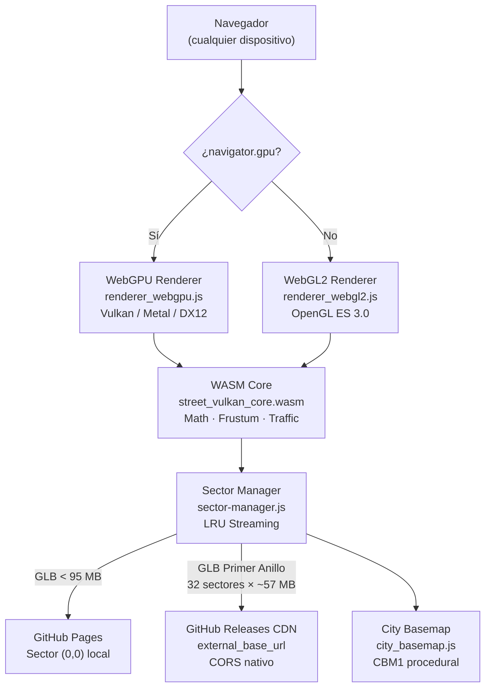
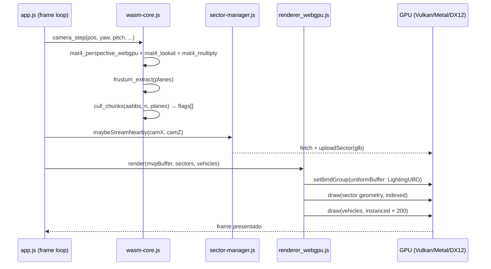
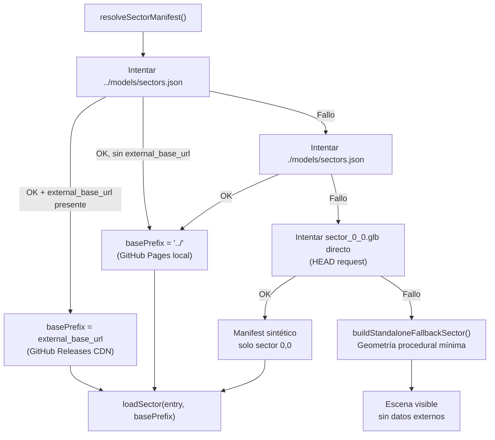

# ISO/IEC 29110 SI.3 — Diseño de Software: Renderizado y Streaming

**Proyecto:** StreetVulkan — Gemelo Digital Urbano 3D de Aguascalientes  
**Actividad:** Implementación de Software (SI) — Fase SI.3: Diseño de Software  
**Autor:** @jefazo-isc · **Revisión:** 1.0 · **Fecha:** 2026-11-26  
**Issue:** [#20](https://github.com/jefazo-isc/aguascavulkan/issues/20)

---

## 1. Visión General de la Arquitectura

StreetVulkan implementa un pipeline de renderizado **dual-API** (WebGPU primario / WebGL2 fallback) con un núcleo matemático en WebAssembly Text puro (`.wat`). La geometría urbana se transmite por streaming desde sectores GLB independientes.



---

## 2. Núcleo WebAssembly (`.wat` → `.wasm`)

### 2.1 Decisión de diseño: WAT puro vs Emscripten

| Criterio | WAT puro ✅ | Emscripten ❌ |
|---|---|---|
| Tamaño binario | 3.9 KB | > 100 KB (runtime) |
| Dependencias | Ninguna | `libemscripten`, `libc` |
| Reproducibilidad | Bit-exact (CI verifica hash) | Depende de versión SDK |
| Transparencia | Legible como ensamblador | C → IR → WASM opaco |
| Funciones exportadas | Exactas, sin bloat | Incluye stdlib completo |

**Alternativa descartada:** Compilar `src/math_camera.c` con Emscripten. Generaba un binario 30× más grande con funcionalidades innecesarias (filesystem virtual, heap JS).

### 2.2 Funciones exportadas (`web/street_vulkan_core.wat`)

| Función | Parámetros | Descripción |
|---|---|---|
| `get_version` | — | Retorna entero de versión |
| `camera_get_vectors` | `pos_ptr, yaw, pitch, fwd_ptr, right_ptr, up_ptr` | Vectores de cámara |
| `camera_step` | `pos_ptr, yaw, pitch, fwd, right, up, speed, dt` | Integra posición |
| `mat4_perspective_webgpu` | `out_ptr, fovy, aspect, znear, zfar` | Proyección NDC Vulkan (Y invertido) |
| `mat4_perspective_webgl` | `out_ptr, fovy, aspect, znear, zfar` | Proyección NDC OpenGL |
| `mat4_lookat` | `out_ptr, eye_xyz, center_xyz, up_xyz` | View matrix |
| `mat4_multiply` | `out_ptr, a_ptr, b_ptr` | Multiplicación 4×4 |
| `frustum_extract` | `planes_ptr, mvp_ptr` | Extrae 6 planos del frustum |
| `cull_chunks` | `aabbs_ptr, n, planes_ptr, flags_ptr` | Frustum culling por lotes |
| `traffic_tick` | `sim_time_ptr, dt` | FSM 4-fases de semáforos |
| `update_vehicle_stream` | `out_ptr, count, ...` | Actualiza stream de vehículos |

### 2.3 Layout de memoria lineal (2 páginas = 128 KiB)

```
Offset  Tamaño  Contenido
------  ------  ---------
0x0000     4 B  Reservado (guarda NULL — paridad ABI C/Emscripten)
0x0004    12 B  Posición cámara [x, y, z] (3 × f32)
0x0010     4 B  Tiempo simulación tráfico (f32)
0x0014    36 B  Vectores cámara: fwd(12), right(12), up(12)
0x0040    64 B  View matrix (16 × f32, column-major)
0x0080    64 B  Proj matrix WebGPU (16 × f32)
0x00C0    64 B  MVP matrix (16 × f32)
0x0100    96 B  6 planos frustum (6 × vec4: a,b,c,d)
0x0160    64 B  Proj matrix WebGL (16 × f32)
0x01A0    64 B  MVP matrix WebGL (16 × f32)
0x0200     …  AABBs de chunks (N × 24 B: minXYZ + maxXYZ)
0x8000     …  Flags de visibilidad (N × 1 B: 0=culled, 1=visible)
```

> **Decisión:** Separar MVP WebGPU/WebGL en offsets distintos permite actualizar ambas matrices en el mismo frame sin doble copia, ya que los dos renderers pueden coexistir en modo diagnóstico.

---

## 3. Formato de Vértice (52 bytes)

Definido en [`include/vertex_format.h`](../../include/vertex_format.h):

```c
typedef struct {
    float position[3];  // 12 B — Posición mundo (metros)
    float normal[3];    // 12 B — Normal de superficie (normalizada)
    float texCoord[2];  //  8 B — UV para textura satelital / atlas
    float color[4];     // 16 B — RGBA (albedo pre-multiplicado)
    float emission;     //  4 B — Factor de emisión (ver tabla)
} Vertex;              // Total: 52 bytes, alineación 4 B
```

### 3.1 Semántica del campo `emission`

| Valor | Significado |
|---|---|
| `0.0` | Geometría estática sin emisión (edificios, suelo) |
| `0.1–0.4` | Ventanas iluminadas (brillo nocturno sutil) |
| `> 0.5` | Faros/calaveras de vehículos |
| `2.0` | HUD / texto de debug (sin iluminación) |
| `>= 4.0` | Lentes de semáforo (penetración visual a distancia) |

### 3.2 Instanciado de vehículos (96 bytes/instancia)

Los vehículos usan un stream separado de instancias que se concatena al VBO en el mismo bind point, con stride diferente:

```
mat4 model (64 B) + vec4 tint (16 B) + float brake (4 B) + pad[3] (12 B) = 96 B
```

La instancia activa se identifica en el vertex shader por `tint.a > 0.5` (vehículo) vs `tint.a == 0.0` (geometría estática).

---

## 4. Pipeline de Renderizado WebGPU



### 4.1 Shader WGSL — Estructura

El shader único `web/shaders.wgsl` cubre:

- **Vertex stage:** Transforma posición con MVP (push-constant equivalente via UBO), propaga normal y UV
- **Fragment stage:** PBR Cook-Torrance (GGX NDF + Smith G + Fresnel Schlick), 64 point lights, spot flashlight, niebla atmosférica, tone mapping ACES
- **Instanced vehicle stage:** Mismo fragment shader; vertex stage lee `mat4` de instance buffer

### 4.2 Fallback WebGL2

`web/renderer_webgl2.js` replica exactamente el mismo pipeline con GLSL ES 3.00. Comparte el mismo `LightingUBO` layout (std140). La diferencia principal: el UBO se sube vía `uniformBlockBinding` en lugar de `setBindGroup`.

**Alternativa descartada:** Usar un renderer simplificado sin PBR para WebGL2. Se descartó para garantizar paridad visual entre backends y poder comparar rendimiento de forma justa.

---

## 5. Streaming de Sectores

### 5.1 Formato de sector GLB

Cada sector es un archivo GLB estándar (GLTF 2.0 binario) generado por `tools/generate_sector.py`. Contiene:
- Una malla única con geometría entrelazada en formato `Vertex` de 52 B
- Sin texturas embebidas (usan el atlas global `texture_atlas_16x16.png`)
- Archivo paralelo `chunks_MX_MZ.json` con AABBs de sub-celdas de 128 m

### 5.2 Parámetros del sistema LRU

| Parámetro | Valor | Archivo |
|---|---|---|
| Radio de carga | 2 400 m | `sector-manager.js:STREAM_LOAD_RADIUS` |
| Radio de descarga | 3 800 m | `sector-manager.js:STREAM_UNLOAD_RADIUS` |
| Máx. sectores activos | 6 | `sector-manager.js:MAX_ACTIVE_SECTORS` |
| Cargas concurrentes | 2 | `sector-manager.js:MAX_CONCURRENT_STREAM_LOADS` |
| Tamaño macro-sector | 1 024 m | `models/sectors.json:macro_size` |
| Tamaño chunk | 128 m | `models/sectors.json:chunk_size` |

### 5.3 Resolución de URLs — Prioridad de fuentes



**Decisión de diseño: `external_base_url` inyectado en CI**  
La URL del CDN externo no está hardcodeada en el JavaScript (evita roturas si cambia el hosting). El script de CI la inyecta en `_site/models/sectors.json` antes del despliegue, y el cliente la consume dinámicamente.

---

## 6. Mapa Base Procedural (CBM1)

Cuando la cámara está lejos de un sector detallado (o el sector aún no ha cargado), se muestra el mapa base generado por `tools/build_city_basemap.py`.

### 6.1 Formato binario CBM1 (`models/city_basemap.bin`)

```
Header (32 B):
  "CBM1"          (4 B magic)
  uint32 n_cells  (número de celdas)
  float  cell_size (metros por celda, 1024.0)
  float  origin_x, origin_z  (coordenadas del origen)
  uint32 reserved[2]

Por celda (variable):
  int32  mx, mz   (coordenadas de celda)
  uint32 n_tris   (número de triángulos)
  Vertex verts[]  (n_tris × 3 × 52 B)
```

### 6.2 LOD del mapa base

Las celdas del mapa base se construyen con geometría simplificada (planos de carretera + extrusión básica de edificios). `web/city_basemap.js` las gestiona con una cache LRU independiente, ocultando las celdas donde hay un sector detallado activo.

---

## 7. Sistema de Iluminación

El UBO `LightingUBO` (1 648 B) se actualiza cada frame con las 64 luces más cercanas seleccionadas por `lighting_system_update()` en `src/lighting_system.c`:

1. **Semáforos activos** (rojo/ámbar/verde según FSM) — hasta 500 candidatos, radio 650 m
2. **Farolas de alumbrado público** — activadas según hora simulada (19:00–07:00), radio 700 m  
3. **Beacons Gemini AI** — 2 balizas cyan fijas (tabla `g_lighting_beacons[]`)

La selección de las 64 más cercanas usa Selection Sort parcial O(n·k) con n ≤ 500, k = 64.

---

## 8. Decisiones de Diseño — Resumen

| Decisión | Alternativa descartada | Razón |
|---|---|---|
| WAT puro para núcleo matemático | Emscripten C→WASM | Binario 30× más pequeño, reproducible bit-exact |
| Vértice de 52 B entrelazado | SOA (arrays separados) | Un solo VBO → menos draw calls, mejor cache coherencia |
| Sectores de 1 024 m | 512 m o 2 048 m | Balance entre granularidad de streaming y overhead de fetch |
| GitHub Releases como CDN | Hugging Face, Cloudflare R2 | Zero-setup, ya autenticado, CORS nativo, 2 GB/archivo |
| Frustum culling en WASM | JS puro | Evita garbage collection, opera sobre memoria lineal continua |
| PBR en WebGL2 y WebGPU | PBR solo en WebGPU | Paridad visual entre backends; permite comparación de rendimiento |
| Shader único WGSL / GLSL | Shaders por material | Simplicidad; el campo `emission` codifica tipo de material |

---

## Referencias

- [`web/sector-manager.js`](../../web/sector-manager.js) — Streaming LRU
- [`web/renderer_webgpu.js`](../../web/renderer_webgpu.js) — Pipeline WebGPU
- [`web/renderer_webgl2.js`](../../web/renderer_webgl2.js) — Pipeline WebGL2
- [`web/street_vulkan_core.wat`](../../web/street_vulkan_core.wat) — Núcleo WASM
- [`web/shaders.wgsl`](../../web/shaders.wgsl) — Shaders WGSL
- [`include/vertex_format.h`](../../include/vertex_format.h) — Formato de vértice
- [`include/lighting_system.h`](../../include/lighting_system.h) — Tipos de iluminación
- [`src/lighting_system.c`](../../src/lighting_system.c) — Sistema de iluminación
- [`tools/build_city_basemap.py`](../../tools/build_city_basemap.py) — Generador CBM1
- [ISO/IEC 29110-5-1-2:2011](https://www.iso.org/standard/51195.html) — Perfil básico SI
