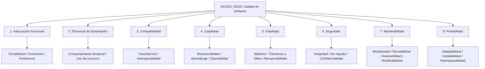

# ISO/IEC 25010 - Modelo de Calidad del Producto de Software
## StreetVulkan 🏙️

Este documento define la evaluación y el marco de aplicación de la norma internacional **ISO/IEC 25010** (Systems and software engineering — Systems and software Quality Requirements and Evaluation, SQuaRE) para el proyecto **StreetVulkan**.

El estándar ISO/IEC 25010 clasifica la calidad del software en **8 características principales** divididas en subcaracterísticas. A continuación se detalla cómo aplica cada una de ellas a la arquitectura, componentes en C/Vulkan y herramientas en Python de StreetVulkan, junto con sus métricas de verificación y estado actual.

---



---

## 1. 🎯 Adecuación Funcional (Functional Suitability)

Grado en que el conjunto de funciones cubre todas las tareas y objetivos especificados para el motor de simulación urbana.

### Subcaracterísticas y Aplicación en StreetVulkan:
- **Completitud Funcional:**
  - Renderizado de geometría urbana a partir de mallas GLTF/GLB (`vulkan_gltf.c`, `cgltf.h`).
  - Simulación de tránsito vehicular y red vial (`car_system.c`, `road_graph.c`).
  - Control de semáforos por fases de tiempo (`traffic_system.c`).
  - Iluminación dinámica y ciclo día/noche con factores ambientales y emisivos (`lighting_system.h`).
  - Generación de geometría procedural de banquetas, calles y edificios (`tools/generate_sector.py`).
- **Corrección Funcional:**
  - Posicionamiento correcto de vehículos respecto al terreno (`vulkan_get_ground_elevation`).
  - Orientación y cálculo de matrices de vista y proyección en Vulkan (`math_camera.c`).
  - Representación fiel de coordenadas geográficas de OpenStreetMap/Overture.
- **Pertinencia Funcional:**
  - Capacidad de inspeccionar la escena mediante cámara libre (WASD + mouse look) e interfaz de telemetría/depuración (`debug_overlay.h`).

---

## 2. ⚡ Eficiencia de Desempeño (Performance Efficiency)

Desempeño relativo a la cantidad de recursos utilizados bajo condiciones declaradas de carga gráfica y simulación.

### Subcaracterísticas y Aplicación en StreetVulkan:
- **Comportamiento Temporal:**
  - Tasa de refresco objetivo: $\ge 60\text{ FPS}$ en renderizado Vulkan nativo.
  - Sincronización de fotogramas mediante swapchain con doble/triple buffering (`vulkan_swapchain.c`, `VK_PRESENT_MODE_FIFO_KHR` o `VK_PRESENT_MODE_MAILBOX_KHR`).
  - Tiempo de render por pase de fotograma medido y expuesto en `telemetry.h` y `debug_overlay.h`.
- **Utilización de Recursos:**
  - Gestión de memoria de GPU mediante buffers dedicados (Vertex Buffers, Index Buffers, Uniform Buffers y Staging Buffers) en `vulkan_device.c`.
  - Consumo de memoria del archivo GLB optimizado ($< 120\text{ MB}$, vértices $< 2.2\text{ M}$).
  - Culling de visión frustum (`frustum_cull.h`) y particionado espacial por bloques/chunks (`chunk_system.h`) para evitar sobrecarga en la pipeline de gráficos.
- **Capacidad:**
  - Capacidad para simular decenas de vehículos en simultáneo y miles de nodos de carreteras sin degradación de latencia de CPU (`car_system.c`).

---

## 3. 🔄 Compatibilidad (Compatibility)

Capacidad del software para intercambiar información con otros componentes o compartir el mismo entorno de hardware y software.

### Subcaracterísticas y Aplicación en StreetVulkan:
- **Coexistencia:**
  - Coexistencia limpia con el gestor de ventanas del sistema operativo y servidor gráfico (X11 / Wayland) mediante abstracción de SDL2 (`SDL_CreateWindow`).
  - Compatibilidad de capas de validación de Vulkan (`VK_LAYER_KHRONOS_validation`) sin interferir con otros controladores gráficos.
- **Interoperabilidad:**
  - Formatos abiertos de estándares industriales:
    - **glTF 2.0 / GLB** mediante [cgltf.h](file:///home/yahir/vulkan/include/cgltf.h).
    - **SPIR-V** para shaders precompilados (`glslangValidator` para compilar GLSL a SPIR-V binario).
    - **GeoJSON / CSV** para ingesta de datos geoespaciales (OSM, Overture Maps, INEGI DENUE).
    - **PNG / QOI / BMP** para texturas y atlas 2D (`stb_image.h`).

---

## 4. 🎮 Usabilidad (Usability)

Grado en que el software puede ser entendido, aprendido, usado y resultar atractivo para los usuarios y desarrolladores.

### Subcaracterísticas y Aplicación en StreetVulkan:
- **Reconocibilidad de su Adecuación:**
  - Documentación clara en [README.md](file:///home/yahir/vulkan/README.md) y diagramas de arquitectura en [docs/](file:///home/yahir/vulkan/docs/).
- **Facilidad de Aprendizaje y Operación:**
  - Controles intuitivos de cámara de tipo videojuego en primera persona (WASD, Espacio, Ctrl, Ratón para mirar).
  - Tecla `TAB` para capturar/liberar el puntero del mouse y `ESC` para pausar/salir mediante [pause_menu.h](file:///home/yahir/vulkan/include/pause_menu.h).
- **Protección contra Errores de Usuario:**
  - Validación de argumentos y verificación de existencia de archivos de activos (`.glb`, shaders SPIR-V `.spv`, atlas de textura) antes de inicializar pipelines.
- **Estética de la Interfaz:**
  - Estilo visual low-poly coherente con paleta pixel-art.
  - HUD / Overlay de depuración nítido con estadísticas en tiempo real (FPS, frame time, posición de cámara, conteo de vértices).

---

## 5. 🛡️ Fiabilidad (Reliability)

Grado en que el sistema mantiene un nivel especificado de rendimiento bajo condiciones establecidas y durante un período de tiempo dado.

### Subcaracterísticas y Aplicación en StreetVulkan:
- **Madurez:**
  - Manejo exhaustivo de códigos de error de Vulkan (`VkResult == VK_SUCCESS`) en cada llamada de API (`vkCreateInstance`, `vkCreateDevice`, `vkAllocateMemory`, etc.).
- **Tolerancia a Fallos:**
  - Verificación de límites de memoria en arrays de vehículos, grafos y vértices (prevención de buffer overflows).
  - Manejo de fallos en shaders si un archivo `.spv` no se encuentra o está corrupto, reportando el error en consola en vez de abortar abruptamente.
- **Capacidad de Recuperación (Recoverability):**
  - Manejo del evento `VK_ERROR_OUT_OF_DATE_KHR` o `VK_SUBOPTIMAL_KHR` en cambios de tamaño de ventana (`vulkan_swapchain.c`), recreando la swapchain de forma limpia sin fugas de recursos.

---

## 6. 🔒 Seguridad (Security)

Capacidad del sistema para proteger información y datos de modo que personas u otros sistemas no autorizados no puedan leerlos ni modificarlos.

### Subcaracterísticas y Aplicación en StreetVulkan:
- **Integridad:**
  - Sanitización en el parser de mallas y archivos de entrada (`cgltf`, cargadores de GeoJSON) evitando deserializaciones inseguras o punteros colgantes.
- **Confidencialidad:**
  - Almacenamiento seguro de llaves de API externas (ej. `GEMINI_API_KEY` para clasificación o generación de monumentos) mediante variables de entorno en lugar de *hardcodear* credenciales en el código fuente.
- **Responsabilidad (Accountability):**
  - Registros de inicialización y errores con marcas de tiempo en el sistema de telemetría y consola.

---

## 7. 🔧 Mantenibilidad (Maintainability)

Grado de efectividad y eficiencia con el que el producto puede ser modificado por los desarrolladores para mejorarlo, corregirlo o adaptarlo a cambios en el entorno.

### Subcaracterísticas y Aplicación en StreetVulkan:
- **Modularidad:**
  - Separación estricta entre capas:
    - **Gráficos Vulkan:** `vulkan.c`, `vulkan_device.c`, `vulkan_pipeline.c`, `vulkan_swapchain.c`, `vulkan_texture.c`.
    - **Lógica de Simulación:** `car_system.c`, `road_graph.c`, `traffic_system.c`.
    - **Matemáticas / Utilidades:** `math_camera.c`, `debug_overlay.h`, `lighting_system.h`.
    - **Pipeline de Datos Procedural:** `tools/generate_sector.py`, `tools/generate_texture_atlas.py`.
- **Reusabilidad:**
  - Funciones matemáticas de vectores/matrices reutilizables en cualquier módulo (`math_camera.h`).
  - Carga genérica de texturas y buffers aplicable a distintos tipos de activos.
- **Analizabilidad:**
  - Integración con capas de validación Khronos (`VK_LAYER_KHRONOS_validation`) y `debug_overlay.h` para inspeccionar el estado interno de la GPU y la CPU.
- **Modificabilidad:**
  - Construcción basada en [Makefile](file:///home/yahir/vulkan/Makefile) claro y desacoplado, permitiendo agregar nuevos módulos fuente con mínimo esfuerzo.
- **Comprobabilidad (Testability):**
  - Scripts en `tools/` ejecutables de forma independiente para generar y verificar atlas o sectores antes de cargar el motor principal.

---

## 8. 📦 Portabilidad (Portability)

Facilidad con la que el sistema puede ser transferido de un entorno de hardware, software u operacional a otro.

### Subcaracterísticas y Aplicación en StreetVulkan:
- **Adaptabilidad:**
  - Arquitectura estándar basada en Vulkan API 1.0+ y C99/C11, compatible con GPUs dedicadas e integradas (AMD, NVIDIA, Intel, Mali/Adreno).
  - Selección dinámica del dispositivo físico (`vulkan_device.c`) basada en el soporte de extensiones (`VK_KHR_swapchain`) y colas gráficas.
- **Instalabilidad:**
  - Dependencias estándar disponibles en repositorios principales de Linux (apt, pacman, dnf): SDL2, libvulkan, glslangValidator.
  - Proceso de compilación estándar en un solo comando: `make clean && make`.
- **Capacidad de Reemplazo:**
  - Abstracción de ventana y entrada mediante SDL2, lo que facilita el soporte multiplataforma (Linux, Windows, macOS con MoltenVK).

---

## 📊 Matriz de Evaluación de Calidad (ISO/IEC 25010)

| Característica | Subcaracterística Clave | Mecanismo de Implementación | Estado |
| :--- | :--- | :--- | :---: |
| **1. Adecuación Funcional** | Completitud, Corrección | Render Vulkan, Simulación Tráfico (`car_system`), Semáforos | ✅ Implementado |
| **2. Eficiencia de Desempeño**| Tasa de FPS, Uso VRAM/RAM | Double buffering, Staging Buffers, Culling Frustum | ✅ Implementado |
| **3. Compatibilidad** | Interoperabilidad de Datos | Formatos abiertos glTF 2.0, GeoJSON, SPIR-V, PNG | ✅ Implementado |
| **4. Usabilidad** | Operabilidad, HUD | Cámara WASD + Mouse Look, Overlay de telemetría | ✅ Implementado |
| **5. Fiabilidad** | Resiliencia, Swapchain recreate | Manejo de VkResult, recreación ante Resize de ventana | ✅ Implementado |
| **6. Seguridad** | Sanitización, Manejo de API Keys | Keys por variables de entorno, validación de buffers | ✅ Implementado |
| **7. Mantenibilidad** | Modularidad, Capas limpias | Separación C / Python / Shaders, Makefile modular | ✅ Implementado |
| **8. Portabilidad** | Independencia de SO y GPU | SDL2 + Vulkan API estándar, soporte Linux/Windows | ✅ Implementado |

---

## 🚀 Guía de Pruebas y Aseguramiento de Calidad

Para evaluar y garantizar el cumplimiento de la norma ISO/IEC 25010 en cada iteración del desarrollo:

1. **Pruebas de Portabilidad y Compilación:**
   ```bash
   make clean && make
   ```
2. **Pruebas de Fiabilidad Gráfica:**
   Activar capas de validación Vulkan para detectar advertencias de memoria o sincronización:
   ```bash
   VK_INSTANCE_LAYERS=VK_LAYER_KHRONOS_validation ./street_vulkan
   ```
3. **Pruebas de Desempeño:**
   Monitorear el conteo de FPS y tiempo de fotograma con la telemetría interna activada en pantalla (`F1` o tecla configurada para `debug_overlay`).
