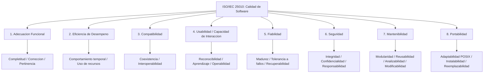

# ISO/IEC 25010 - Modelo de Calidad del Producto de Software
## StreetVulkan 🏙️

Este documento define la evaluación y el marco de aplicación de la norma internacional **ISO/IEC 25010** (*Systems and software engineering — Systems and software Quality Requirements and Evaluation, SQuaRE*) para el proyecto **StreetVulkan**.

El estándar ISO/IEC 25010 clasifica la calidad del producto de software en **8 características principales** divididas en subcaracterísticas (observando además la evolución en la revisión 2023 hacia *Interaction Capability* y *Safety*, mientras la medición en [ISO/IEC 25023](ISO_IEC_25023.md) cuantifica estas 8 características base). A continuación se detalla cómo aplica cada una a la arquitectura en C11/Vulkan 1.2 y al pipeline geoespacial en Python de StreetVulkan, junto con su estado verificado y su deuda técnica abierta.

---



---

## 1. 🎯 Adecuación Funcional (Functional Suitability)

Grado en que el conjunto de funciones cubre todas las tareas y objetivos especificados para el motor de simulación urbana.

### Subcaracterísticas y Aplicación en StreetVulkan:
- **Completitud Funcional:**
  - Renderizado de geometría urbana a partir de mallas glTF 2.0/GLB ([vulkan_gltf.c](../src/vulkan_gltf.c), [cgltf.h](../include/cgltf.h)) y streaming por macro-sectores ([sector_system.c](../src/sector_system.c)).
  - Simulación cinemática de `200` vehículos y red vial binaria `RGP1` ([car_system.c](../src/car_system.c), [road_graph.c](../src/road_graph.c)).
  - Control determinista de semáforos de 6 fases ([traffic_system.c](../src/traffic_system.c)).
  - Iluminación dinámica PBR Cook-Torrance y ciclo día/noche con hasta 64 luces puntuales y linterna ([lighting_system.h](../include/lighting_system.h), [fragment.frag](../shaders/fragment.frag)).
  - Generación de geometría procedural de banquetas, calles, puentes y edificios ([generate_sector.py](../tools/generate_sector.py), [bridge_generator.py](../tools/bridge_generator.py)).
  - **Alcance pendiente documentado:** El módulo peatonal ([ped_system.h](../include/ped_system.h), [ped_system.c](../src/ped_system.c)) cuenta con lógica cinemática/semafórica validada en pruebas unitarias CPU (`test_ped_system()`), pero permanece pendiente de integración visual instanciada en GPU ([ROADMAP_FUTURO.md](ROADMAP_FUTURO.md)).
- **Corrección Funcional:**
  - Posicionamiento preciso respecto al terreno mediante `vulkan_get_ground_elevation` en [vulkan.c](../src/vulkan.c), delegando a `terrain_dem_get_elevation()` en [terrain_dem_data.h](../include/terrain_dem_data.h) sobre la grilla `64x64` con datum unificado `1871.0 m`, 4 ríos y 2 fallas geológicas consistentes con [geo_dem.py](../tools/geo_dem.py).
  - Orientación y cálculo de matrices de vista y proyección Vulkan ([math_camera.c](../src/math_camera.c)).
- **Pertinencia Funcional:**
  - Inspección libre de la escena (WASD + ratón), menú de pausa/testing ([pause_menu.h](../include/pause_menu.h)) e interfaz de telemetría en vivo ([debug_overlay.h](../include/debug_overlay.h), [telemetry.h](../include/telemetry.h)).

---

## 2. ⚡ Eficiencia de Desempeño (Performance Efficiency)

Desempeño relativo a la cantidad de recursos utilizados bajo condiciones declaradas de carga gráfica y simulación.

### Subcaracterísticas y Aplicación en StreetVulkan:
- **Comportamiento Temporal:**
  - Tasa de refresco objetivo: $\ge 60\text{ FPS}$ ($T_{\text{frame}} \le 16.67\text{ ms}$) con simulación física a paso fijo (`FIXED_DELTA_TIME = 1/60 s`) en [main.c](../src/main.c).
  - Sincronización mediante `MAX_FRAMES_IN_FLIGHT = 2` y swapchain Vulkan ([vulkan_swapchain.c](../src/vulkan_swapchain.c)).
  - Tiempo de CPU y GPU por fotograma medido con `SDL_GetPerformanceCounter()` y `VkQueryPool` en [telemetry.h](../include/telemetry.h) y [vulkan.c](../src/vulkan.c).
- **Utilización de Recursos:**
  - Subasignadores centralizados separados por tipo de memoria (`vramBufferPool`, `vramImagePool`, `hostVisiblePool`) en [vulkan_memory_pool.c](../src/vulkan_memory_pool.c) respetando `bufferImageGranularity`.
  - Carga Zero-Copy con `mmap` + `MADV_SEQUENTIAL` en [vulkan_gltf.c](../src/vulkan_gltf.c) y partición en `401` macro-sectores modulares ($\le 76.94\text{ MB}$ cada uno, debajo del límite de $99\text{ MB}$; máximo recomendado por sector $\le 120\text{ MB}$).
  - Culling frustum ([frustum_cull.h](../include/frustum_cull.h)) sobre `14,605` chunks espaciales de `128 m` ([chunk_system.h](../include/chunk_system.h)).
- **Capacidad:**
  - Simulación simultánea de `200` vehículos instanciados (`6` draw calls), `552` semáforos en `201` intersecciones y grafo vial de `34,658` nodos / `48,640` aristas.

---

## 3. 🔄 Compatibilidad (Compatibility)

Capacidad del software para intercambiar información con otros componentes o compartir el mismo entorno de hardware y software.

### Subcaracterísticas y Aplicación en StreetVulkan:
- **Coexistencia:**
  - Coexistencia con gestores de ventanas Linux (X11 / Wayland) mediante SDL2 (`SDL_CreateWindow` con `SDL_WINDOW_VULKAN`).
  - Compatibilidad con capas de validación de Vulkan (`VK_LAYER_KHRONOS_validation`) bajo compilación `make debug` ([vulkan_device.c](../src/vulkan_device.c)).
- **Interoperabilidad:**
  - Formatos abiertos estándar:
    - **glTF 2.0 / GLB** mediante [cgltf.h](../include/cgltf.h).
    - **SPIR-V** compilado desde GLSL 450 ([vertex.vert](../shaders/vertex.vert), [fragment.frag](../shaders/fragment.frag)) vía `glslangValidator`.
    - **GeoJSON / XML / CSV** para ingesta geoespacial (OSM, Overture Maps, INEGI DENUE).
    - **PNG / JPG** para texturas satelitales y atlas 2D ([stb_image.h](../include/stb_image.h)).

---

## 4. 🎮 Usabilidad / Capacidad de Interacción (Usability)

Grado en que el software puede ser entendido, aprendido, usado y resultar atractivo para los usuarios y desarrolladores.

### Subcaracterísticas y Aplicación en StreetVulkan:
- **Reconocibilidad de su Adecuación:**
  - Documentación integral en [README.md](../README.md) y guías técnicas/metodológicas ([OPENUP_TSP.md](OPENUP_TSP.md), [SCRUM_XP.md](SCRUM_XP.md), [ISO_IEC_25012_25024.md](ISO_IEC_25012_25024.md), [ESTIMACION_Y_TRAZABILIDAD.md](ESTIMACION_Y_TRAZABILIDAD.md)).
- **Facilidad de Aprendizaje y Operación:**
  - Controles estándar de cámara libre (WASD, Espacio, Ctrl/C, Shift para sprint, Ratón para pitch/yaw).
  - Tecla `TAB` para capturar/liberar el cursor y `ESC`/`P` para menú de pausa y testing en vivo mediante [pause_menu.h](../include/pause_menu.h) (presets horarios, teleporte, escala de tiempo, modo semafórico, linterna).
- **Protección contra Errores de Usuario:**
  - Validación de existencia de activos y manejo explícito de punteros `NULL` en loaders y sistemas de simulación.
- **Estética de la Interfaz:**
  - HUD / Overlay de telemetría 5×7 en NDC ([debug_overlay.h](../include/debug_overlay.h)) con estadísticas en tiempo real.

---

## 5. 🛡️ Fiabilidad (Reliability)

Grado en que el sistema mantiene un nivel especificado de rendimiento bajo condiciones establecidas y durante un período de tiempo dado.

### Subcaracterísticas y Aplicación en StreetVulkan:
- **Madurez:**
  - Verificación explícita de códigos `VkResult == VK_SUCCESS` en creación de instancia, dispositivo, swapchain, pipeline y buffers.
  - Verificación de memoria y comportamiento indefinido mediante `make asan-test` (AddressSanitizer + UBSan) sobre [test_c_modules.c](../tests/test_c_modules.c).
- **Tolerancia a Fallos:**
  - Fallback resiliente en `init_satellite_texture()` ([vulkan_texture.c](../src/vulkan_texture.c)): ante ausencia de `assets/satellite*.png`, genera una textura neutra `4x4` y continúa creando `textureSampler`, `lightingBuffers` y `descriptorSets` sin dejar descriptores sin inicializar; `vulkan_init` aborta limpiamente si la inicialización de texturas/descriptores retorna `0`.
  - Validación de dimensiones en `load_quadrant_satellite()` antes de copiar memoria y comprobación de soporte físico para `samplerAnisotropy` y capacidades `BLIT_SRC`/`BLIT_DST`.
  - Verificación de límites en arrays de vehículos, intersecciones, sectores y buffers dinámicos.
- **Capacidad de Recuperación (Recoverability):**
  - Recreación limpia ante `VK_ERROR_OUT_OF_DATE_KHR` o `VK_SUBOPTIMAL_KHR` ([vulkan_swapchain.c](../src/vulkan_swapchain.c)) y liberación diferida segura de macro-sectores en [sector_system.c](../src/sector_system.c).

---

## 6. 🔒 Seguridad (Security)

Capacidad del sistema para proteger información y datos de modo que personas u otros sistemas no autorizados no puedan leerlos ni modificarlos.

### Subcaracterísticas y Aplicación en StreetVulkan:
- **Integridad:**
  - Validación de cabeceras binarias (`RGP1`, glTF 2.0) y límites de archivos antes de copiar memoria o indexar buffers.
- **Confidencialidad:**
  - Aislamiento de llaves de API externas (`GEMINI_API_KEY` vía `.env` / variables de entorno no rastreadas) verificado automáticamente por [measure_iso25023.py](../tools/metrics/measure_iso25023.py).
- **Responsabilidad (Accountability):**
  - Registros diagnósticos estructurados en consola, exportación JSON de telemetría ([telemetry.h](../include/telemetry.h)) y scorecard auditable en `build/quality_scorecard.json`.

---

## 7. 🔧 Mantenibilidad (Maintainability)

Grado de efectividad y eficiencia con el que el producto puede ser modificado por los desarrolladores para mejorarlo, corregirlo o adaptarlo a cambios en el entorno.

### Subcaracterísticas y Aplicación en StreetVulkan:
- **Modularidad:**
  - Separación entre capas C/Vulkan (`src/`, `include/`), shaders GLSL ([vertex.vert](../shaders/vertex.vert), [fragment.frag](../shaders/fragment.frag)) y pipeline Python (`tools/`).
  - Descomposición de la generación procedural en [sector_terrain.py](../tools/sector_terrain.py) y [sector_roads.py](../tools/sector_roads.py).
- **Reusabilidad:**
  - Utilidades matemáticas ([math_camera.h](../include/math_camera.h)), frustum culling ([frustum_cull.h](../include/frustum_cull.h)) y pool de memoria ([vulkan_memory_pool.h](../include/vulkan_memory_pool.h)) reutilizables entre subsistemas.
- **Analizabilidad (Deuda Técnica Abierta):**
  - Aunque la compilación con `-Wall -Wextra -O2` produce `0` advertencias en los `15` archivos `.c`, el analizador estático [measure_maintainability.py](../tools/metrics/measure_maintainability.py) sobre `38` archivos propios (`233` funciones) detecta **deuda técnica abierta**: `16` funciones con complejidad ciclomática de McCabe `CC > 20` (máxima `CC = 70` en `gltf_load_direct_vulkan`) y densidad de comentarios de `4.8%` (`< 5.0%`), cuya refactorización está programada para **Tier B**.
- **Modificabilidad y Comprobabilidad (Testability):**
  - Construcción automatizada mediante [Makefile](../Makefile) modular (`all`, `debug`, `test`, `asan-test`, `metrics`, `quality`) y verificación continua en [ci.yml](../.github/workflows/ci.yml).
  - Pruebas unitarias desacopladas en [test_c_modules.c](../tests/test_c_modules.c) y [test_python_tools.py](../tests/test_python_tools.py).

---

## 8. 📦 Portabilidad (Portability)

Facilidad con la que el sistema puede ser transferido de un entorno de hardware, software u operacional a otro.

### Subcaracterísticas y Aplicación en StreetVulkan:
- **Adaptabilidad (Alcance Linux/POSIX):**
  - El motor en C está diseñado y compilado específicamente para **entornos Linux/POSIX** con GCC, SDL2 y Vulkan API 1.2 (`VK_API_VERSION_1_2`).
  - Hace uso directo de primitivas POSIX del sistema operativo:
    - `mmap()`, `madvise()`, `open()`, `fstat()`, `close()` en [vulkan_gltf.c](../src/vulkan_gltf.c) para mapeo Zero-Copy de `.glb`.
    - `pthread_t`, `pthread_mutex_t`, `pthread_cond_t` en [sector_system.c](../src/sector_system.c) y [sector_system.h](../include/sector_system.h) para streaming asíncrono.
    - `DIR*`, `opendir()`, `readdir()` (`<dirent.h>`) y `access()` (`<unistd.h>`) en [vulkan.c](../src/vulkan.c) y [vulkan_texture.c](../src/vulkan_texture.c).
  - En consecuencia, un eventual porte a Windows nativo requeriría sustituir estas llamadas POSIX por equivalentes Win32 (`CreateFileMapping`, `MapViewOfFile`, hilos Win32/C11, `FindFirstFile`); la portabilidad actual está acotada a distribuciones Linux/POSIX con soporte Vulkan.
- **Instalabilidad:**
  - Dependencias estándar disponibles en repositorios Linux (`build-essential`, `libsdl2-dev`, `libvulkan-dev`, `glslang-tools`, `python3`), compilables con `make clean && make`.
- **Capacidad de Reemplazo:**
  - Selección dinámica de GPU Vulkan y formatos estándar glTF 2.0 / SPIR-V independientes de fabricante gráfico (NVIDIA, AMD, Intel).

---

## 📊 Matriz de Evaluación de Calidad (ISO/IEC 25010)

| Característica | Subcaracterística Clave | Mecanismo de Implementación | Estado Real |
| :--- | :--- | :--- | :---: |
| **1. Adecuación Funcional** | Completitud, Corrección | Render Vulkan, tráfico `car_system`, semáforos, DEM unificado `1871.0 m` (`terrain_dem_data.h`). `ped_system` probado en CPU; **pendiente de render GPU**. | ⚠️ Parcial (peatones en GPU pendientes) |
| **2. Eficiencia de Desempeño** | Tasa FPS, Uso VRAM/RAM | Double buffering, `VulkanMemoryPool`, `mmap` Zero-Copy, frustum culling sobre chunks `128 m` | ✅ Implementado |
| **3. Compatibilidad** | Interoperabilidad de Datos | glTF 2.0/GLB, SPIR-V, GeoJSON/OSM/DENUE, PNG | ✅ Implementado |
| **4. Usabilidad** | Operabilidad, HUD | Cámara WASD + Ratón, menú de pausa (`ESC`/`P`), overlay de telemetría | ✅ Implementado |
| **5. Fiabilidad** | Resiliencia, Tolerancia a Fallos | Chequeos `VkResult`, fallback `4x4` en `vulkan_texture.c`, recreación swapchain, `make asan-test` | ✅ Implementado |
| **6. Seguridad** | Sanitización, Manejo de API Keys | `GEMINI_API_KEY` vía entorno (`0` fugas en Git), validación de límites y binarios | ✅ Implementado |
| **7. Mantenibilidad** | Modularidad, Analizabilidad | `0` warnings GCC, pruebas XP C/Python y Makefile modular; **deuda abierta: funciones `CC > 20`** para Tier B | ⚠️ Deuda Técnica Tier B |
| **8. Portabilidad** | Adaptabilidad POSIX / Linux | GCC + SDL2 + Vulkan 1.2 sobre **Linux/POSIX** (`mmap`, `pthread`, `dirent`, `unistd`) | ⚠️ Acotado a Linux/POSIX |

---

## 🚀 Guía de Pruebas y Aseguramiento de Calidad

Para evaluar y garantizar el cumplimiento de ISO/IEC 25010 en cada iteración:

1. **Compilación Limpia (0 warnings):**
   ```bash
   make clean && make
   ```
2. **Pruebas Unitarias XP (C y Python):**
   ```bash
   make test
   ```
3. **Verificación de Memoria y Comportamiento Indefinido (ASan/UBSan):**
   ```bash
   make asan-test
   ```
4. **Auditoría Cuantitativa Consolidada ISO/IEC SQuaRE:**
   ```bash
   make metrics
   ```
5. **Validación Gráfica Vulkan en Tiempo de Ejecución (sesión con display):**
   ```bash
   make debug && VK_INSTANCE_LAYERS=VK_LAYER_KHRONOS_validation ./street_vulkan
   ```
