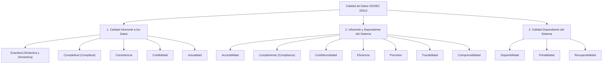

# ISO/IEC 25012 e ISO/IEC 25024 — Modelo y Medición de Calidad de Datos
## StreetVulkan 🏙️

Este documento formaliza la evaluación y auditoría cuantitativa de la calidad de los datos geoespaciales, topográficos, viales y de activos 3D del proyecto **StreetVulkan**, aplicando las normas internacionales de la familia **ISO/IEC 25000 (SQuaRE)**:

- **ISO/IEC 25012:2008** (*Data quality model*): Define el modelo conceptual de calidad de datos mediante **15 características** agrupadas en **Calidad Inherente a los Datos** y **Calidad Dependiente del Sistema** (incluyendo la intersección de ambas).
- **ISO/IEC 25024:2015** (*Measurement of data quality*): Establece el conjunto de medidas cuantitativas, fórmulas y propiedades observables para evaluar si los conjuntos de datos son adecuados para su uso previsto (*fit for purpose*).

---

## 1. Arquitectura Conceptual del Modelo de Calidad de Datos (ISO/IEC 25012)



### Relación Causal entre Calidad de Datos, Producto y Uso

En StreetVulkan, la calidad del renderizado urbano y de la simulación vehicular/semafórica depende directamente de los artefactos generados por el pipeline geoespacial en `tools/` (por ejemplo [generate_sector.py](../tools/generate_sector.py) y [geo_dem.py](../tools/geo_dem.py)). De acuerdo con el modelo causal SQuaRE:

1. **Calidad de Datos (ISO/IEC 25012 / 25024):** Si un registro en `traffic_signals.json` contiene coordenadas `NaN`, un `.glb` referenciado en `sectors.json` falta en disco o una muestra DEM cae fuera del rango altitudinal de Aguascalientes, los datos pierden exactitud, completitud o consistencia.
2. **Calidad del Producto de Software (ISO/IEC 25010 / 25023):** El motor C/Vulkan ([sector_system.c](../src/sector_system.c), [road_graph.c](../src/road_graph.c), [traffic_system.c](../src/traffic_system.c)) depende de la integridad binaria (`RGP1`, glTF 2.0) y de la consistencia espacial de los AABB.
3. **Calidad en Uso (ISO/IEC 25022):** El usuario final experimenta una ciudad sin huecos de geometría, sin vehículos flotando sobre el terreno y con semáforos sincronizados.

---

## 2. Definición de las 15 Características (ISO/IEC 25012) en StreetVulkan

| Punto de Vista | Característica | Definición (ISO/IEC 25012) | Aplicación Concreta en StreetVulkan |
| :--- | :--- | :--- | :--- |
| **Inherente** | **1. Exactitud** | Grado en que los datos representan el valor verdadero sintáctico y semántico en su contexto de uso. | Elevaciones DEM dentro del rango geográfico real de Aguascalientes ($[1000, 3000]\text{ msnm}$; observado $1827.00\text{–}2008.17\text{ m}$), colores RGB en $[0.0, 1.0]$ y coordenadas finitas (`isfinite`). |
| **Inherente** | **2. Completitud (Complitud)** | Grado en que los atributos esperados e instancias relacionadas poseen valores no nulos. | Presencia de todos los campos obligatorios (`id`, `intersection`, `phase`, `x`, `y`, `z` en semáforos; `id`, `type`, `label`, `color` en edificios; `44` filas de atributos en diccionario DENUE). |
| **Inherente** | **3. Consistencia** | Grado en que los datos carecen de contradicciones y son coherentes entre fuentes relacionadas. | Emparejamiento 1:1 entre los 401 sectores declarados en `sectors.json` y sus archivos `.glb`; validez de AABBs (`min <= max` en X/Y/Z) en `chunks.json`. |
| **Inherente** | **4. Credibilidad** | Grado en que los datos se consideran verdaderos y confiables por su origen oficial o verificable. | Fuentes primarias certificadas: INEGI DENUE Aguascalientes, NASA SRTM / Mapzen Terrarium, OpenStreetMap y Overture Maps. |
| **Inherente** | **5. Actualidad** | Grado en que los datos tienen la vigencia temporal adecuada para el dominio de simulación. | Diccionario DENUE fechado `20/05/2026`, extracción de edificios Overture/OSM y caché DEM Terrarium 64×64 actualizados en el ciclo de construcción del proyecto. |
| **Inherente y Dependiente** | **6. Accesibilidad** | Facilidad con la que los datos pueden ser consultados por usuarios o módulos autorizados. | Carga directa desde estructuras abiertas (JSON, JSONL, CSV, glTF 2.0) y formato binario mapeable `RGP1` sin requerir servidores externos en tiempo de ejecución. |
| **Inherente y Dependiente** | **7. Cumplimiento** | Adhesión de los datos a estándares, convenciones o regulaciones vigentes. | Conformidad de mallas con Khronos glTF 2.0 (límite modular $\le 99\text{ MB}$ por sector), codificación SCIAN 2018 en DENUE y unidades métricas SI (metros, m/s). |
| **Inherente y Dependiente** | **8. Confidencialidad** | Garantía de acceso restringido a datos sensibles o credenciales. | Exclusión de datos personales de personas físicas en DENUE y aislamiento de `GEMINI_API_KEY` fuera de los archivos de datos y del código rastreado en Git. |
| **Inherente y Dependiente** | **9. Eficiencia** | Relación entre el almacenamiento/procesamiento requerido por los datos y la capacidad del sistema. | Empaquetado binario compacto `road_network.bin` (`3.66 MB` para 34,658 nodos y 48,640 aristas), partición en chunks de `128 m` y macro-sectores de `1024 m` ($\le 76.94\text{ MB}$). |
| **Inherente y Dependiente** | **10. Precisión** | Nivel de detalle y discriminación numérica de los valores almacenados. | Coordenadas `float32` en sistema métrico local centrado en `(21.8807, -102.2965)`, grilla DEM de `64x64` muestras y radios de rueda/bbox milimétricos en `cars/manifest.json`. |
| **Inherente y Dependiente** | **11. Trazabilidad** | Capacidad de rastrear origen, transformaciones y auditoría de los datos. | Preservación de `id` de edificio/semáforo, campo `street_name`, claves DENUE/SCIAN y scripts reproductores deterministas en `tools/`. |
| **Inherente y Dependiente** | **12. Comprensibilidad** | Facilidad de interpretación de los datos mediante metadatos y convenciones claras. | Documentación explícita de columnas en `denue_diccionario_de_datos.csv`, etiquetas legibles (`label` en español) en `classified_buildings.json` y cabeceras autodescriptivas. |
| **Dependiente del Sistema** | **13. Disponibilidad** | Grado en que los datos están listos y recuperables al iniciar el motor. | Cachés locales en `models/` (`dem_terrarium_*.json`, `road_network.bin`, `sectors.json`) que evitan depender de red en tiempo de ejecución. |
| **Dependiente del Sistema** | **14. Portabilidad** | Capacidad de trasladar los datos entre entornos preservando su semántica y estructura. | Uso de formatos independientes de arquitectura (JSON UTF-8, glTF 2.0 little-endian, PNG, binario `RGP1` con empaquetado explícito `#pragma pack(push, 1)`). |
| **Dependiente del Sistema** | **15. Recuperabilidad** | Capacidad de preservar operación o degradar de forma segura ante ausencia parcial de datos. | Fallback automático de modo macro-sectores a malla monolítica o validación de errores en [road_graph.c](../src/road_graph.c) y [sector_system.c](../src/sector_system.c) ante rutas faltantes. |

---

## 3. Catálogo de Medidas Cuantitativas (ISO/IEC 25024)

Siguiendo la norma **ISO/IEC 25024**, la auditoría implementada en [validate_data_quality.py](../tools/metrics/validate_data_quality.py) cuantifica las características críticas mediante las siguientes fórmulas:

| ID Medida | Característica ISO 25012 | Dimensión ISO 25024 | Fórmula Matemática | Umbral de Aceptación |
| :--- | :--- | :--- | :--- | :---: |
| **DQ-CMP-01** | Completitud | Contextual | $X = \frac{N_{\text{registros\_campos\_obligatorios\_válidos}}}{N_{\text{registros\_totales}}}$ | $X \ge 0.99\ (99\%)$ |
| **DQ-ACC-01** | Exactitud | Intrínseca | $X = \frac{N_{\text{muestras\_finitas\_en\_rango\_físico}}}{N_{\text{muestras\_totales}}}$ | $X \ge 0.99\ (99\%)$ |
| **DQ-CON-01** | Consistencia | Representacional | $X = \frac{N_{\text{referencias\_resueltas\_o\_invariantes\_válidos}}}{N_{\text{elementos\_evaluados}}}$ | $X = 1.00\ (100\%)$ |
| **DQ-INT-01** | Integridad Estructural | Intrínseca / Eficiencia | $\mathbb{I}\!\left(\text{magic}=\text{RGP1} \land B_{\text{real}} = B_{\text{esperado}}\right)$ | $\text{Verdadero}\ (100\%)$ |
| **DQ-AVL-01** | Disponibilidad de Activos | Accesibilidad | $N_{\text{glb\_faltantes}} = \sum \mathbb{I}(\neg\text{existe}(\text{archivo}))$ | $N_{\text{faltantes}} = 0$ |
| **DQ-UND-01** | Comprensibilidad | Representacional | $N_{\text{filas\_diccionario}} > 1$ (metadatos activos) | $N_{\text{filas}} \ge 2$ |

---

## 4. Resultados Empíricos de los 8 Conjuntos de Datos Auditados

Ejecución verificada de `python3 tools/metrics/validate_data_quality.py` sobre los artefactos reales en `models/`:

| # | Conjunto de Datos | Archivo / Patrón | Registros / Elementos | Medición ISO/IEC 25024 | Resultado Real | Estado |
| :---: | :--- | :--- | :--- | :--- | :--- | :---: |
| **1** | **Semáforos Georreferenciados** | [traffic_signals.json](../models/traffic_signals.json) | `552` señales (`201` intersecciones; fases `0`: 268, `1`: 284) | Completitud (`DQ-CMP-01`) + Validez numérica | `valid=552`, `invalid_coords=0`, `completeness=1.0` | **PASS** |
| **2** | **Edificios Clasificados** | [classified_buildings.json](../models/classified_buildings.json) | `325,511` registros (`residence_1f`: 310,445; `commercial_local`: 9,982; `industrial`: 2,955; etc.) | Completitud de esquema + RGB $\in [0, 1]^3$ | `valid=325511`, `completeness=1.0` | **PASS** |
| **3** | **Manifiesto de Macro-Sectores** | [sectors.json](../models/sectors.json) $\to$ `models/sectors/*.glb` | `401` sectores indexados (`63,795,162` vértices; máx. `76.94 MB` $\le 99\text{ MB}$) | Consistencia referencial (`DQ-CON-01`) | `existing_glb=401`, `missing=0`, `consistency=1.0` | **PASS** |
| **4** | **Grafo Vial Binario** | [road_network.bin](../models/road_network.bin) | `34,658` nodos, `48,640` aristas, `133,518` puntos | Integridad estructural `RGP1` (`DQ-INT-01`) | `magic=RGP1`, `actual_bytes=3657312`, `expected_bytes=3657312` | **PASS** |
| **5** | **Particionado Espacial (Chunks)** | [chunks.json](../models/chunks.json) | `14,605` chunks (`chunk_size=128.0 m`, `46,036,509` vértices) | Consistencia geométrica de AABBs (`DQ-CON-01`) | `valid_aabbs=14605`, `consistency=1.0` | **PASS** |
| **6** | **Modelos Digitales de Elevación** | `models/dem_*.json` (`7` archivos) | `23,680` muestras altitudinales (`1827.00 m` a `2008.17 m`) | Exactitud de rango físico $[1000, 3000]\text{ m}$ (`DQ-ACC-01`) | `files=7`, `samples=23680`, `valid_samples=23680`, `accuracy=1.0` | **PASS** |
| **7** | **Manifiestos de Vehículos y Peatones** | [cars/manifest.json](../models/cars/manifest.json) y [peds/manifest.json](../models/peds/manifest.json) | `6` tipos de vehículo (`sedan`, `compacto`, `pickup`, `van`, `taxi`, `bus`) + `4` variantes peatonales | Disponibilidad referencial de `.glb` (`DQ-AVL-01`) | `car_types=6`, `ped_variants=4`, `missing_glb=0` | **PASS** |
| **8** | **Diccionario de Datos INEGI DENUE** | [denue_diccionario_de_datos.csv](../models/diccionario_de_datos/denue_diccionario_de_datos.csv) | `44` filas lógicas no vacías (metadatos de `71,871` registros en `denue_inegi_01_.csv`) | Comprensibilidad / Metadatos (`DQ-UND-01`) | `rows=44` | **PASS** |

---

## 5. Detalle Técnico de Validación por Conjunto de Datos

### 5.1 Semáforos (`models/traffic_signals.json`)
- **Productor:** [gltf_writer.py](../tools/gltf_writer.py) / [sector_roads.py](../tools/sector_roads.py).
- **Consumidor en C:** [traffic_system_load_json](../src/traffic_system.c) y [lighting_system_init](../include/lighting_system.h).
- **Reglas verificadas:** Formato JSON Lines válido por línea; existencia de claves `id`, `intersection`, `phase`, `x`, `y`, `z`; coordenadas finitas no nulas (`math.isfinite`).
- **Hallazgo:** `552 / 552` registros íntegros ($100.0\%$), distribuidos en `201` intersecciones reales de Aguascalientes.

### 5.2 Clasificación Semántica de Edificios (`models/classified_buildings.json`)
- **Productor:** [classify_buildings.py](../tools/classify_buildings.py) mediante cruce espacial (`SpatialGrid2D`) entre Overture Maps, OpenStreetMap y el directorio económico INEGI DENUE.
- **Reglas verificadas:** Presencia de `id`, `type`, `label`, `color`; arreglo `color` de longitud 3 con componentes flotantes normalizadas en $[0.0, 1.0]$.
- **Hallazgo:** `325,511 / 325,511` registros completos ($100.0\%$).

### 5.3 Macro-Sectores 3D (`models/sectors.json` y `models/sectors/*.glb`)
- **Productor:** [split_glb_to_sectors.py](../tools/split_glb_to_sectors.py) (`MACRO_SIZE = 1024.0 m`, `CHUNK_SIZE = 128.0 m`, restricción estricta `MAX_FILE_BYTES = 99 MB`).
- **Consumidor en C:** [sector_system_init](../src/sector_system.c) con streaming asíncrono POSIX (`pthread`).
- **Reglas verificadas:** Cada entrada declarada en `sectors.json` apunta a un archivo `.glb` existente en disco y ningún sector supera el límite de tamaño operativo (máximo medido `76.94 MB`).

### 5.4 Grafo Vial Binario (`models/road_network.bin`)
- **Productor:** [generate_road_graph.py](../tools/generate_road_graph.py) usando `geo_dem.TerrainElevation` y topología OSM.
- **Consumidor en C:** [road_graph_load](../src/road_graph.c) y [car_system_update](../src/car_system.c), verificado también por la prueba unitaria `test_road_graph_binary()` en [test_c_modules.c](../tests/test_c_modules.c).
- **Estructura verificada:**
  $$B_{\text{esperado}} = 16 + (N_{\text{nodos}} \times 20) + (N_{\text{aristas}} \times 28) + (N_{\text{puntos}} \times 12)$$
  Con $N_{\text{nodos}} = 34,658$, $N_{\text{aristas}} = 48,640$ y $N_{\text{puntos}} = 133,518$:
  $$B_{\text{esperado}} = 16 + 693,160 + 1,361,920 + 1,602,216 = 3,657,312\text{ bytes}$$
  Exactamente igual al tamaño real en disco (`3,657,312` bytes) y encabezado `RGP1`.

### 5.5 Chunks Espaciales (`models/chunks.json`)
- **Consumidor en C:** [chunk_system_load](../include/chunk_system.h) y [frustum_test_aabb](../include/frustum_cull.h).
- **Reglas verificadas:** `chunk_size = 128.0 > 0`, `count > 0` vértices por chunk y AABBs válidos ($\text{min}_x \le \text{max}_x$, $\text{min}_y \le \text{max}_y$, $\text{min}_z \le \text{max}_z$) en los `14,605` registros.

### 5.6 Cachés Topográficas DEM (`models/dem_*.json`)
- **Productor:** [geo_dem.py](../tools/geo_dem.py) (decodificación Mapzen Terrarium `(R*256 + G + B/256) - 32768`).
- **Archivos auditados (7):**
  1. [dem_cache_21.800_21.950_-102.370_-102.245_64x64.json](../models/dem_cache_21.800_21.950_-102.370_-102.245_64x64.json) (`64x64 = 4,096` pts, $[1827.00, 2006.00]\text{ m}$)
  2. [dem_cache_21.869_21.894_-102.311_-102.281_40x40.json](../models/dem_cache_21.869_21.894_-102.311_-102.281_40x40.json) (`40x40 = 1,600` pts, $[1847.00, 1885.00]\text{ m}$)
  3. [dem_cache_40x40.json](../models/dem_cache_40x40.json) (`40x40 = 1,600` pts, $[1847.00, 1890.00]\text{ m}$)
  4. [dem_terrarium_21.800_21.950_-102.370_-102.245_64x64.json](../models/dem_terrarium_21.800_21.950_-102.370_-102.245_64x64.json) (`64x64 = 4,096` pts, $[1830.28, 2008.17]\text{ m}$)
  5. [dem_terrarium_21.840_21.930_-102.340_-102.240_64x64.json](../models/dem_terrarium_21.840_21.930_-102.340_-102.240_64x64.json) (`64x64 = 4,096` pts, $[1830.00, 2007.77]\text{ m}$)
  6. [dem_terrarium_21.879_21.891_-102.298_-102.285_64x64.json](../models/dem_terrarium_21.879_21.891_-102.298_-102.285_64x64.json) (`64x64 = 4,096` pts, $[1863.75, 1884.06]\text{ m}$)
  7. [dem_terrarium_21.880_21.891_-102.297_-102.286_64x64.json](../models/dem_terrarium_21.880_21.891_-102.297_-102.286_64x64.json) (`64x64 = 4,096` pts, $[1864.18, 1884.00]\text{ m}$)
- **Nota de Gobernanza de Datos (Datum Base):** Durante la auditoría técnica de integración se detectó que la grilla embebida en C (`terrain_dem_data.h`) usaba históricamente un archivo `40x40` con cota base `1865.0 m`, mientras que el generador de terreno ([geo_dem.py](../tools/geo_dem.py)) utiliza la grilla `64x64` (`dem_terrarium_21.800_21.950_-102.370_-102.245_64x64.json`) con datum `1871.0 m`. La unificación a `1871.0 m` elimina la divergencia altitudinal entre los datos estáticos del motor y la malla procedural.

### 5.7 Manifiestos de Vehículos y Peatones (`models/{cars,peds}/manifest.json`)
- **Productores:** [convert_car_models.py](../tools/convert_car_models.py) y [procedural_peds.py](../tools/procedural_peds.py).
- **Verificación:** Los `6` tipos vehiculares (`car_bus.glb`, `car_compacto.glb`, `car_pickup.glb`, `car_sedan.glb`, `car_taxi.glb`, `car_van.glb`) y la malla base peatonal ([ped.glb](../models/peds/ped.glb)) están presentes en disco sin referencias huérfanas (`missing_glb = 0`).

### 5.8 Diccionario de Datos DENUE (`denue_diccionario_de_datos.csv`)
- **Propósito ISO 25012 (Comprensibilidad y Trazabilidad):** Documenta tipos, longitudes y significado semántico (ej. `id`, `nom_estab`, `raz_social`, `codigo_act` SCIAN 2018, `per_ocu`) de las unidades económicas contenidas en [denue_inegi_01_.csv](../models/conjunto_de_datos/denue_inegi_01_.csv) (`71,872` líneas).
- **Observación de codificación:** El CSV original de INEGI contiene caracteres en codificación heredada Latin-1/Windows-1252, por lo que [validate_data_quality.py](../tools/metrics/validate_data_quality.py) emplea `encoding="utf-8-sig", errors="replace"` para garantizar lectura portable sin fallos de decodificación.

---

## 6. Resumen del Scorecard ISO/IEC 25012 & 25024

```text
=== Auditoria ISO/IEC 25012 & 25024 (Calidad de Datos) ===
[PASS] models/traffic_signals.json -> records=552, valid=552, invalid_coords=0, completeness=1.0
[PASS] models/classified_buildings.json -> records=325511, valid=325511, completeness=1.0
[PASS] models/sectors.json -> models/sectors/*.glb -> records=401, existing_glb=401, missing=0, consistency=1.0
[PASS] models/road_network.bin -> magic=RGP1, nodes=34658, edges=48640, points=133518, actual_bytes=3657312, expected_bytes=3657312
[PASS] models/chunks.json -> chunk_size=128.0, records=14605, valid_aabbs=14605, consistency=1.0
[PASS] models/dem_*.json -> files=7, samples=23680, valid_samples=23680, accuracy=1.0
[PASS] models/{cars,peds}/manifest.json -> car_types=6, ped_variants=4, missing_glb=0
[PASS] models/diccionario_de_datos/denue_diccionario_de_datos.csv -> rows=44
Resultado Global: 8/8 conjuntos de datos aprobados (100.0%)
```
