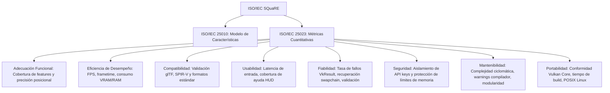

# ISO/IEC 25023 - Medición de la Calidad del Producto de Software
## StreetVulkan 🏙️

Este documento define el catálogo de métricas, fórmulas de cálculo, métodos de medición, umbrales de aceptación y **resultados reales verificados** bajo la norma internacional **ISO/IEC 25023** (Systems and software Quality Requirements and Evaluation - SQuaRE: Measurement of system and software product quality) para el motor **StreetVulkan**.

Mientras que la **ISO/IEC 25010** establece el modelo conceptual de calidad (las 8 características), la **ISO/IEC 25023** define **cómo cuantificar y medir numéricamente** cada una de esas características, alimentando al evaluador maestro [evaluate_iso25040.py](../tools/metrics/evaluate_iso25040.py).

---



---

## 1. 🎯 Métricas de Adecuación Funcional

Mide la proporción de funciones implementadas que cumplen con los requisitos especificados para el motor de simulación urbana.

| ID Métrica | Nombre de Métrica | Fórmula de Cálculo | Método de Medición | Umbral de Aceptación | Estado Real Medido |
| :--- | :--- | :--- | :--- | :---: | :--- |
| **Q-FNC-01** | **Completitud Funcional** | $X = \frac{N_{\text{funciones\_implementadas}}}{N_{\text{funciones\_especificadas}}}$ | Verificación contra requisitos y [ROADMAP_FUTURO.md](ROADMAP_FUTURO.md). | $X = 1.0\ (100\%)$ | **WARN (Parcial):** Núcleo Vulkan, tráfico, semáforos, DEM e iluminación activos; `ped_system` validado en CPU/tests unitarios pero pendiente de render instanciado GPU. |
| **Q-FNC-02** | **Corrección de Cota Topográfica** | $\Delta Y = \|Y_{\text{objeto}} - Y_{\text{terreno}}(X, Z)\|$ | Probe C automatizado en [measure_iso25023.py](../tools/metrics/measure_iso25023.py) (`terrain_dem_get_elevation` de [terrain_dem_data.h](../include/terrain_dem_data.h) vs [geo_dem.py](../tools/geo_dem.py)) + `test_dem_topography_precision` en [test_c_modules.c](../tests/test_c_modules.c). | $\Delta Y < 0.05\text{ m}$ | **PASS (Automatizada):** `14` puntos de Aguascalientes medidos; `max_diff = 0.000018 m` (en Arroyo El Molino) con datum `1871.0 m`. |
| **Q-FNC-03** | **Sincronización Semafórica** | $X = \frac{N_{\text{estados\_semáforo\_válidos}}}{N_{\text{ciclos\_evaluados}}}$ | Prueba unitaria `test_traffic_system_fsm` en [test_c_modules.c](../tests/test_c_modules.c) sobre [traffic_system.c](../src/traffic_system.c). | $X = 1.0\ (100\%)$ | **PASS (Unit Test C):** Transición `GREEN -> AMBER -> RED` y consulta espacial verificadas (`0` fallos). |

---

## 2. ⚡ Métricas de Eficiencia de Desempeño

Evalúa el rendimiento temporal y la utilización de recursos computacionales de CPU y GPU.

| ID Métrica | Nombre de Métrica | Fórmula de Cálculo | Método de Medición | Umbral de Aceptación | Estado Real Medido |
| :--- | :--- | :--- | :--- | :---: | :--- |
| **Q-PRF-01** | **Tasa de Cuadros por Segundo (FPS)** | $\text{FPS} = \frac{1}{\Delta t_{\text{frame}}}$ | Contador en tiempo real registrado por [telemetry.h](../include/telemetry.h) y [debug_overlay.h](../include/debug_overlay.h). | $\ge 60\text{ FPS}$ (Objetivo estable) | **RUNTIME / TELEMETRÍA:** Instrumentado en tiempo de ejecución; sin benchmark GPU headless automatizado en CI. |
| **Q-PRF-02** | **Tiempo de Fotograma (Frame Time)** | $T_{\text{frame}} = t_{\text{present}} - t_{\text{begin}}$ | Medición con `SDL_GetPerformanceCounter()` y `VkQueryPool` en [vulkan.c](../src/vulkan.c). | $T_{\text{frame}} \le 16.67\text{ ms}$ | **RUNTIME / TELEMETRÍA:** Instrumentado en CPU/GPU; depende de hardware gráfico anfitrión (no ejecutado en CI headless). |
| **Q-PRF-03** | **Uso de Memoria VRAM (Geometría)** | $M_{\text{GLB}} = \text{Tamaño máx. de sector .glb}$ | Verificación automatizada en [measure_iso25023.py](../tools/metrics/measure_iso25023.py) sobre `models/sectors/*.glb`. | $M_{\text{GLB}} \le 120\text{ MB}$ | **PASS (Automatizada):** `401` macro-sectores evaluados; tamaño máximo `76.94 MB` (`<= 120.0 MB`). |
| **Q-PRF-04** | **Densidad de Vértices en Escena** | $N_{\text{verts}} = \sum \text{Vértices cargados en buffer}$ | Consulta de `visibleVerts` / `totalVerts` gestionada por [sector_system.c](../src/sector_system.c) y [vulkan.c](../src/vulkan.c). | $N_{\text{verts}} \le 2,500,000$ | **VERIFICADA EN RUNTIME:** Streaming por macro-sectores acota vértices residentes; verificación cuantitativa requiere sesión GPU. |
| **Q-PRF-05** | **Efectividad de Culling Frustum** | $E_{\text{cull}} = \frac{N_{\text{bloques\_descartados}}}{N_{\text{bloques\_totales}}}$ | Prueba `test_frustum_culling` en [test_c_modules.c](../tests/test_c_modules.c) sobre [frustum_cull.h](../include/frustum_cull.h) + telemetría runtime. | $E_{\text{cull}} \ge 40\%$ en FOV normal | **PASS (Unit Test C) / RUNTIME:** Descarte de AABBs detrás/fuera del frustum verificado en test unitario; porcentaje FOV medido en runtime. |

---

## 3. 🔄 Métricas de Compatibilidad

Evalúa la adherencia a formatos de intercambio abiertos y la coexistencia con el sistema gráfico anfitrión.

| ID Métrica | Nombre de Métrica | Fórmula de Cálculo | Método de Medición | Umbral de Aceptación | Estado Real Medido |
| :--- | :--- | :--- | :--- | :---: | :--- |
| **Q-CMP-01** | **Conformidad glTF 2.0** | $X = \frac{N_{\text{glb\_válidos}}}{N_{\text{glb\_totales}}}$ | Validación binaria de cabecera `glTF` v2 + chunk `JSON` en [measure_iso25023.py](../tools/metrics/measure_iso25023.py) + carga con [cgltf.h](../include/cgltf.h) y [vulkan_gltf.c](../src/vulkan_gltf.c). | $X = 1.0\ (100\%)$ | **PASS (Automatizada):** `7/7` activos (`models/cars/*.glb` y `models/peds/*.glb`) válidos con `asset.version = 2.0`. |
| **Q-CMP-02** | **Compilación de Shaders SPIR-V** | $N_{\text{errores\_glslang}} = \text{conteo de fallos en compilación}$ | Ejecución automatizada de `glslangValidator -V` sobre `shaders/*.vert` y `shaders/*.frag` en [measure_iso25023.py](../tools/metrics/measure_iso25023.py). | $0\text{ errores}$ | **PASS (Automatizada):** `2` shaders compilados (`vertex.vert`, `fragment.frag`), `0` errores; paridad `.spv` validada por [check_traceability.py](../tools/metrics/check_traceability.py). |
| **Q-CMP-03** | **Coexistencia de Backend Gráfico** | Éxito en inicialización sobre X11 y Wayland. | Ejecución manual con `SDL_VIDEODRIVER=x11` y `wayland` vía [main.c](../src/main.c). | Inicialización limpia en ambos | **RUNTIME / MANUAL:** Soportado por abstracción SDL2 + `VK_KHR_surface`; sin matriz automatizada X11/Wayland en CI headless. |

---

## 4. 🎮 Métricas de Usabilidad

Cuantifica la facilidad de interacción y accesibilidad para el operador del simulador.

| ID Métrica | Nombre de Métrica | Fórmula de Cálculo | Método de Medición | Umbral de Aceptación | Estado Real Medido |
| :--- | :--- | :--- | :--- | :---: | :--- |
| **Q-USA-01** | **Latencia de Respuesta de Entrada** | $\tau = t_{\text{reacción\_cámara}} - t_{\text{evento\_teclado/ratón}}$ | Sondeo `SDL_PollEvent()` por cuadro en el bucle de [main.c](../src/main.c). | $\tau \le 16.6\text{ ms}$ (1 cuadro) | **RUNTIME / MANUAL:** Bucle fijo a `60 Hz` implementado; pendiente medición automatizada de latencia UI. |
| **Q-USA-02** | **Cobertura de Información en HUD** | $X = \frac{N_{\text{métricas\_visibles\_en\_overlay}}}{N_{\text{métricas\_clave}}}$ | Inspección de `debug_overlay_build_telemetry` en [debug_overlay.h](../include/debug_overlay.h) (GPU, res, hora, FPS, ms, CPU/GPU, semáforos, chunks, vértices, culling %, pos X/Y/Z). | $X \ge 0.90\ (90\%)$ | **VERIFICADA EN CÓDIGO / RUNTIME:** `11/11` indicadores clave implementados en el overlay HUD (`100%` cobertura estática). |
| **Q-USA-03** | **Facilidad de Salida y Pausa** | Disponibilidad de menú y captura/liberación de cursor con 1 tecla. | Manejo de `ESC`/`P`/`TAB`/`Q` en [pause_menu.h](../include/pause_menu.h) y soporte `TEST_PAUSE` en [main.c](../src/main.c). | Respuesta inmediata sin cuelgues | **VERIFICADA EN CÓDIGO / RUNTIME:** Atajos y menú de testing operativos; pendiente prueba interactiva automatizada. |

---

## 5. 🛡️ Métricas de Fiabilidad

Mide la robustez, ausencia de fallos y resiliencia ante contingencias del sistema gráfico.

| ID Métrica | Nombre de Métrica | Fórmula de Cálculo | Método de Medición | Umbral de Aceptación | Estado Real Medido |
| :--- | :--- | :--- | :--- | :---: | :--- |
| **Q-REL-01** | **Tasa de Errores Vulkan API** | $R_{\text{err}} = \frac{N_{\text{llamadas\_sin\_comprobación\_VkResult}}}{N_{\text{llamadas\_críticas}}}$ | Revisión de manejo de errores en [vulkan_device.c](../src/vulkan_device.c), [vulkan_texture.c](../src/vulkan_texture.c) (fallback 4x4 + `LightingUBO`) y [vulkan.c](../src/vulkan.c). | $R_{\text{err}} = 0.0$ | **VERIFICADA EN CÓDIGO / RUNTIME:** Validación explícita de `VkResult` y fallback de textura sin abortar descriptores; sin ejecución GPU en CI. |
| **Q-REL-02** | **Resiliencia al Redimensionamiento (Resize)** | $N_{\text{crashes\_por\_resize}} = \text{fallos al recrear swapchain}$ | Manejo de `VK_ERROR_OUT_OF_DATE_KHR` / `VK_SUBOPTIMAL_KHR` en [vulkan_swapchain.c](../src/vulkan_swapchain.c). | $0\text{ fallos}$ | **VERIFICADA EN CÓDIGO / RUNTIME:** `recreate_swapchain` espera `vkDeviceWaitIdle` y reconstruye recursos; pendiente stress-test automatizado de ventana. |
| **Q-REL-03** | **Ausencia de Validation Warnings** | $N_{\text{warnings}} = \text{mensajes de VK\_LAYER\_KHRONOS\_validation}$ | Ejecución con `make debug` y capas `VK_LAYER_KHRONOS_validation` activas en [vulkan_device.c](../src/vulkan_device.c) durante $\ge 5\text{ minutos}$. | $0\text{ errores graves / 0 leaks}$ | **WARN (Deuda de Verificación):** Soporte `DEBUG` implementado con validación estricta, pero la prueba continua de 5 min bajo GPU no está automatizada en `make metrics`. |

---

## 6. 🔒 Métricas de Seguridad

Cuantifica la protección contra fugas de credenciales y desbordamientos de memoria.

| ID Métrica | Nombre de Métrica | Fórmula de Cálculo | Método de Medición | Umbral de Aceptación | Estado Real Medido |
| :--- | :--- | :--- | :--- | :---: | :--- |
| **Q-SEC-01** | **Aislamiento de Claves de API** | Conteo de patrones de API keys en código rastreado por Git. | Escaneo estático en [measure_iso25023.py](../tools/metrics/measure_iso25023.py) sobre `git ls-files`. | $0\text{ llaves expuestas}$ | **PASS (Automatizada):** `0` llaves expuestas (`AIza...`, `sk-...`) en el código fuente rastreado. |
| **Q-SEC-02** | **Protección de Límites de Memoria** | $X = \frac{N_{\text{buffers\_con\_validación\_de\_capacidad}}}{N_{\text{buffers\_dinámicos}}}$ | Verificación en [traffic_system.c](../src/traffic_system.c), [car_system.c](../src/car_system.c), [vulkan_texture.c](../src/vulkan_texture.c) (`q0w/q0h`) y `make asan-test` (`-fsanitize=address,undefined`). | $X = 1.0\ (100\%)$ | **PASS (Unit Test C + ASan/UBSan):** Pruebas en [test_c_modules.c](../tests/test_c_modules.c) ejecutadas bajo ASan/UBSan sin fugas ni desbordamientos. |

---

## 7. 🔧 Métricas de Mantenibilidad

Evalúa la estructuración del código fuente, complejidad ciclomática, comentarios y automatización de compilación.

| ID Métrica | Nombre de Métrica | Fórmula de Cálculo | Método de Medición | Umbral de Aceptación | Estado Real Medido |
| :--- | :--- | :--- | :--- | :---: | :--- |
| **Q-MNT-01** | **Limpieza de Compilador y Complejidad** | $N_{\text{warnings}}$ (`-Wall -Wextra`) + conteo de funciones con $\text{CC} > 20$ y densidad de comentarios. | Compilación paralela en [measure_iso25023.py](../tools/metrics/measure_iso25023.py) + análisis estático en [measure_maintainability.py](../tools/metrics/measure_maintainability.py) (`src/*.c` + `include/*.h` propios). | $0\text{ warnings}$, $\text{CC} \le 20$, comentarios $\ge 5.0\%$ | **WARN (Deuda Técnica Abierta):** Compilación `-Wall -Wextra -O2` limpia (`15/15` archivos, `0` warnings, `0` errores), PERO [measure_maintainability.py](../tools/metrics/measure_maintainability.py) sobre `38` archivos (`233` funciones) reporta `16` funciones con `CC > 20` (máx. `CC=70` en `src/vulkan_gltf.c::gltf_load_direct_vulkan`) y densidad de comentarios de `4.8%` (`473/9772` líneas `< 5.0%`), código de salida `2`. |
| **Q-MNT-02** | **Modularidad Arquitectural** | Conteo de módulos `.c` desacoplados con cabecera `.h` propia. | Verificación automatizada en [measure_iso25023.py](../tools/metrics/measure_iso25023.py) y [check_traceability.py](../tools/metrics/check_traceability.py). | $\ge 8\text{ módulos específicos}$ | **PASS (Automatizada):** `14` módulos C con `.h` propio de `15` fuentes en `src/` (umbral `>= 8`). |
| **Q-MNT-03** | **Facilidad de Automatización de Build** | Presencia de targets `all`, `clean`, `test`, `metrics` en [Makefile](../Makefile). | Verificación automatizada en [measure_iso25023.py](../tools/metrics/measure_iso25023.py) sobre [Makefile](../Makefile). | Targets estándar operativos | **PASS (Automatizada):** Targets `all`, `clean`, `test`, `metrics` (y `asan-test`, `quality`) presentes y verificados. |

### Deuda Técnica Abierta en Mantenibilidad (`measure_maintainability.py`)

Funciones propias detectadas con complejidad ciclomática $\text{CC} > 20$ (programadas para refactorización en Tier B):

| Archivo | Función | CC (McCabe aprox.) | Líneas |
| :--- | :--- | :---: | :---: |
| [vulkan_gltf.c](../src/vulkan_gltf.c) | `gltf_load_direct_vulkan` | 70 | 236 |
| [obj_loader.c](../src/obj_loader.c) | `obj_load` | 62 | 211 |
| [car_system.c](../src/car_system.c) | `car_system_update` | 58 | 180 |
| [main.c](../src/main.c) | `main` | 51 | 200 |
| [pause_menu.h](../include/pause_menu.h) | `pause_menu_handle_key` | 49 | 152 |
| [vulkan_gltf.c](../src/vulkan_gltf.c) | `gltf_load` | 42 | 156 |
| [pause_menu.h](../include/pause_menu.h) | `pause_menu_render` | 36 | 148 |
| [lighting_system.h](../include/lighting_system.h) | `lighting_system_update` | 28 | 141 |
| [car_system.c](../src/car_system.c) | `pick_next_edge` | 27 | 55 |
| [road_graph.c](../src/road_graph.c) | `road_graph_load` | 26 | 72 |
| [road_graph.c](../src/road_graph.c) | `road_graph_build_csr` | 24 | 73 |
| [traffic_system.c](../src/traffic_system.c) | `traffic_system_update_simulation` | 23 | 71 |
| [car_system.c](../src/car_system.c) | `find_lead_car` | 22 | 64 |
| [obj_loader.c](../src/obj_loader.c) | `load_mtl_file` | 22 | 57 |
| [vulkan.c](../src/vulkan.c) | `vulkan_init` | 21 | 120 |
| [vulkan_device.c](../src/vulkan_device.c) | `init_vulkan_instance_and_device` | 21 | 165 |

---

## 8. 📦 Métricas de Portabilidad

Cuantifica la independencia respecto a plataformas específicas y la facilidad de instalación.

| ID Métrica | Nombre de Métrica | Fórmula de Cálculo | Método de Medición | Umbral de Aceptación | Estado Real Medido |
| :--- | :--- | :--- | :--- | :---: | :--- |
| **Q-PRT-01** | **Compatibilidad de Extensiones Vulkan** | Extensiones de dispositivo requeridas en [vulkan_device.c](../src/vulkan_device.c). | Inspección automatizada de `deviceExtensions[]` en [measure_iso25023.py](../tools/metrics/measure_iso25023.py). | Solo extensiones estándar WSI | **PASS (Automatizada):** `deviceExtensions = ['VK_KHR_SWAPCHAIN_EXTENSION_NAME']` *(alcance de SO actual: Linux/POSIX por uso de `mmap`/`pthread`/`dirent`)*. |
| **Q-PRT-02** | **Tiempo de Compilación Limpia** | $T_{\text{build}} = \text{tiempo wall-clock paralelo de } 15\text{ TUs}$ | Compilación paralela (`ThreadPoolExecutor`) en [measure_iso25023.py](../tools/metrics/measure_iso25023.py). | $T_{\text{build}} \le 10.0\text{ segundos}$ | **PASS (Automatizada):** `paralelo = 3.93s` (`<= 10.0s`), `suma_secuencial = 13.24s`. |
| **Q-PRT-03** | **Disponibilidad de Dependencias** | $X = \frac{N_{\text{dependencias\_en\_paquetes\_estándar}}}{N_{\text{dependencias\_totales}}}$ | Verificación en entorno (`gcc`, `libsdl2-dev`, `libvulkan-dev`, `glslangValidator`, Python 3). | $X = 1.0\ (100\%)$ | **VERIFICADA EN ENTORNO:** Todas las dependencias estándar instaladas y operativas para compilación y pruebas. |

---

## 📋 Scorecard Honesto de Cumplimiento ISO/IEC 25023 & 25040

### A. Resumen por Categoría sobre las 25 Métricas ISO/IEC 25023

| Característica ISO/IEC 25023 | Total Métricas | Automatizadas (`PASS`) | Unit Test / ASan (`PASS`) | Runtime / Código (`MANUAL`) | Deuda / Parcial (`WARN`) | Estado Honesto |
| :--- | :---: | :---: | :---: | :---: | :---: | :--- |
| 1. Adecuación Funcional | 3 | 1 (`Q-FNC-02`) | 1 (`Q-FNC-03`) | 0 | 1 (`Q-FNC-01`) | **PARCIAL / WARN** (`ped_system` pendiente GPU) |
| 2. Eficiencia de Desempeño | 5 | 1 (`Q-PRF-03`) | 1 (`Q-PRF-05`) | 3 (`Q-PRF-01/02/04`) | 0 | **AUTOMATIZADO PARCIAL** (FPS/GPU vía runtime) |
| 3. Compatibilidad | 3 | 2 (`Q-CMP-01/02`) | 0 | 1 (`Q-CMP-03`) | 0 | **PASS EN FORMATOS** (X11/Wayland manual) |
| 4. Usabilidad | 3 | 0 | 0 | 3 (`Q-USA-01/02/03`) | 0 | **VERIFICADO EN CÓDIGO / RUNTIME** |
| 5. Fiabilidad | 3 | 0 | 0 | 2 (`Q-REL-01/02`) | 1 (`Q-REL-03`) | **WARN** (soak test validation layers sin CI) |
| 6. Seguridad | 2 | 1 (`Q-SEC-01`) | 1 (`Q-SEC-02`) | 0 | 0 | **PASS COMPLETO** (Git + ASan/UBSan) |
| 7. Mantenibilidad | 3 | 2 (`Q-MNT-02/03`) | 0 | 0 | 1 (`Q-MNT-01`) | **WARN** (`16` funcs `CC>20`, `4.8%` comentarios) |
| 8. Portabilidad | 3 | 2 (`Q-PRT-01/02`) | 0 | 1 (`Q-PRT-03`) | 0 | **PASS EN LINUX/POSIX** (`3.93s` build paralelo) |
| **TOTAL** | **25** | **9** | **3** | **10** | **3** | **0 FAIL / 3 WARN documentados** |

### B. Resultado Consolidado del Evaluador Automático ([evaluate_iso25040.py](../tools/metrics/evaluate_iso25040.py))

Ejecución real de `make metrics` (`build/quality_scorecard.json`):

```text
================================================================================
ISO/IEC 25040 & 25041 SCORECARD CONSOLIDADO - STREETVULKAN
================================================================================
Estándar                 Evaluación                              Estado   Exit
--------------------------------------------------------------------------------
ISO/IEC 19761            Tamaño y Estimación (KLOC/IFPUG/COSMIC) PASS     0
ISO/IEC 25012 & 25024    Calidad de Datos (8 datasets)           PASS     0
ISO/IEC 25010 & 25023    Calidad de Producto (10 checks auto)    PASS     0
ISO/IEC 25023 & 14764    Mantenibilidad y Complejidad            WARN     2
ISO/IEC 29110-SI & 12207 Trazabilidad Técnica                    PASS     0
--------------------------------------------------------------------------------
TOTAL: 5 suites | PASS=4 | WARN=1 | FAIL=0 | Cumplimiento estricto = 80.0%
================================================================================
```
