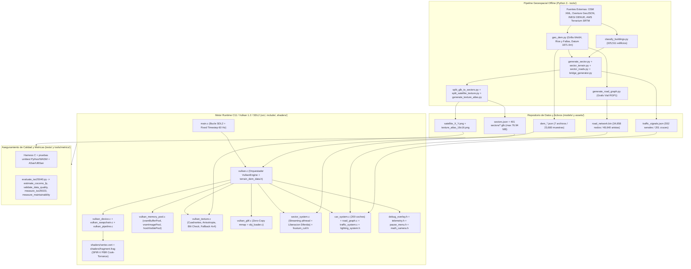

# Proceso Integrado OpenUP-TSP y Formatos PSP Aplicados a StreetVulkan (Parte I — 30%)
## Metodologías de Desarrollo de Sistemas (UAA Clave 24967)

Este documento presenta la aplicación rigurosa del **Proceso Integrado OpenUP-TSP** y los formatos del **Personal Software Process (PSP)** al proyecto **StreetVulkan**, siguiendo la terminología y estructura del curso *Metodologías de Desarrollo de Sistemas* (Universidad Autónoma de Aguascalientes, Clave `24967`, Dr. Manuel Mora / Dr. Carlos Arévalo, Unidad III) y en alineación con **ISO/IEC/IEEE 24748-4** e **ISO/IEC 29110**.

---

## 1. Fundamentos del Proceso Integrado OpenUP-TSP en StreetVulkan

**OpenUP (Open Unified Process)** es la variante ligera, iterativa y centrada en la arquitectura del Proceso Unificado (Eclipse Process Framework), sustentada en cuatro principios aplicados directamente en StreetVulkan:

1. **Colaborar para alinear intereses y compartir conocimiento:** Sincronización continua entre desarrollo de motor gráfico C11/Vulkan, ingeniería de datos geoespaciales Python y aseguramiento de calidad SQuaRE.
2. **Balancear prioridades para maximizar el valor:** Entrega temprana del renderizador 3D y simulación vial sobre el área metropolitana de Aguascalientes antes de optimizaciones secundarias (peatones GPU o monumentos IA).
3. **Centrarse en la arquitectura de forma temprana:** Definición desde la fase de Elaboración del formato binario `RGP1`, la partición espacial en macro-sectores $\le 99\text{ MB}$ (`sectors.json`), carga Zero-Copy con `mmap` y separación de subasignadores Vulkan (`vramBufferPool`, `vramImagePool`, `hostVisiblePool`).
4. **Desarrollo evolutivo para obtener retroalimentación y mejorar:** Microincrementos medibles validados mediante compilación estricta (`-Wall -Wextra`), pruebas unitarias headless (`make test`), sanitizadores (`make asan-test`) y auditorías cuantitativas (`make metrics`).

Por su parte, el **Team Software Process (TSP)** y el **Personal Software Process (PSP)** (Watts S. Humphrey, SEI/CMU) aportan la disciplina de medición de tamaño (`SLOC`/`FP`), registro de tiempo por fase, registro de defectos inyectados/removidos, valor ganado ($EV, PV, AC$) y autogestión de roles para producir software confiable y predecible.

---

## 2. Matriz OpenUP: 4 Fases × 5 Flujos de Trabajo y Artefactos Reales

| Flujo de Trabajo OpenUP | 1. Inicio (*Inception*) | 2. Elaboración (*Elaboration*) | 3. Construcción (*Construction*) | 4. Transición (*Transition*) |
| :--- | :--- | :--- | :--- | :--- |
| **1. Gestión de Proyecto** | **Documento de Visión**, **Lista de Stakeholders**, **Lista de Riesgos Iniciales** (ej. límite 99 MB/archivo, precisión DEM), Plan inicial y lanzamiento TSP. | **Plan de Iteraciones**, asignación de roles TSP, estimación temprana IFPUG/COCOMO-II y calibración de métricas en [estimate_cocomo_fp.py](../tools/metrics/estimate_cocomo_fp.py). | Seguimiento de avance por iteración, registro de tiempo/defectos PSP, gestión de deuda técnica Tier B y compuerta CI ([ci.yml](../.github/workflows/ci.yml)). | **Documento de Cierre / Postmortem**, scorecard consolidado `build/quality_scorecard.json` ([evaluate_iso25040.py](../tools/metrics/evaluate_iso25040.py)) y revisión de hitos. |
| **2. Requerimientos** | Captura de necesidades de simulación urbana en Aguascalientes (vialidades, edificios, tráfico, ciclo solar) y restricciones ISO/IEC SQuaRE. | Especificación de requerimientos suplementarios de desempeño ($\ge 60\text{ FPS}$, $\Delta Y < 0.05\text{ m}$), diccionario DENUE ([denue_diccionario_de_datos.csv](../models/diccionario_de_datos/denue_diccionario_de_datos.csv)) y catálogo IFPUG/COSMIC. | Refinamiento de requisitos técnicos (ej. manejo sin textura satelital, sincronización semafórica en cruces, streaming 1 km × 1 km) en [SCRUM_XP.md](SCRUM_XP.md). | Validación de criterios de aceptación contra matriz de trazabilidad en [ESTIMACION_Y_TRAZABILIDAD.md](ESTIMACION_Y_TRAZABILIDAD.md). |
| **3. Arquitectura** | Evaluación de viabilidad técnica: Vulkan 1.2 + SDL2 + GLSL 450 + pipeline geoespacial Python (OSM/Overture/SRTM). | **Arquitectura Base Ejecutable**: [vulkan_types.h](../include/vulkan_types.h), [vulkan_memory_pool.h](../include/vulkan_memory_pool.h), [road_graph.h](../include/road_graph.h), [sector_system.h](../include/sector_system.h), [lighting_system.h](../include/lighting_system.h). | Evolución de arquitectura modular: desacoplamiento de [sector_terrain.py](../tools/sector_terrain.py) y [sector_roads.py](../tools/sector_roads.py); unificación topográfica en [terrain_dem_data.h](../include/terrain_dem_data.h). | Evaluación arquitectural final bajo [ISO_IEC_25010.md](ISO_IEC_25010.md) y registro de mejoras futuras en [ROADMAP_FUTURO.md](ROADMAP_FUTURO.md). |
| **4. Desarrollo y Pruebas** | Prototipos exploratorios de geodesia ([topography_math.py](../tools/topography_math.py), [geo_dem.py](../tools/geo_dem.py)) y malla de prueba ([test.obj](../models/test.obj)). | Implementación del núcleo gráfico ([vulkan.c](../src/vulkan.c), [vulkan_device.c](../src/vulkan_device.c), [vulkan_swapchain.c](../src/vulkan_swapchain.c), [vulkan_pipeline.c](../src/vulkan_pipeline.c), [vulkan_gltf.c](../src/vulkan_gltf.c)) y shaders SPIR-V. | Construcción incremental de [car_system.c](../src/car_system.c), [traffic_system.c](../src/traffic_system.c), [sector_system.c](../src/sector_system.c), [ped_system.c](../src/ped_system.c), pruebas C/Python ([test_c_modules.c](../tests/test_c_modules.c), [test_python_tools.py](../tests/test_python_tools.py)) y correcciones Tier S. | Ejecución integral `make quality` (`clean`, `all`, `test`, `asan-test`, `metrics`), auditoría de datos [ISO_IEC_25012_25024.md](ISO_IEC_25012_25024.md) y verificación de cero regresiones. |
| **5. Distribución** | Definición del entorno objetivo **Linux/POSIX** (GCC, SDL2, Vulkan SDK, `glslangValidator`). | Automatización de build en [Makefile](../Makefile) y estructura de activos modulares en [split_glb_to_sectors.py](../tools/split_glb_to_sectors.py). | Empaquetado de `401` macro-sectores (`models/sectors.json`), grafo `road_network.bin` y `4` cuadrantes satelitales (`assets/satellite_*.png`). | **Manual Técnico y Guía de Instalación** en [README.md](../README.md), ejecutable `./street_vulkan` y reporte final de calidad. |
| **Hito / Checkpoint** | **Hito LCO (*Lifecycle Objectives*):** Visión, alcance y riesgos aprobados. | **Hito LCA (*Lifecycle Architecture*):** Esqueleto Vulkan + `RGP1` + streaming validado. | **Hito IOC (*Initial Operational Capability*):** Simulación completa + correcciones Tier S sin `FAIL`. | **Hito PR (*Product Release*):** Suite documental y scorecard ISO/IEC auditados. |

---

## 3. Documento de Visión y Lista de Stakeholders

### 3.1 Documento de Visión (Resumen Ejecutivo)
- **Problema:** Los modelos urbanos 3D a escala metropolitana (en este caso Aguascalientes, con más de `325,000` edificios y `48,000` segmentos viales) superan rápidamente `2 GB` en formato monolítico, provocando agotamiento de RAM/VRAM, tiempos de arranque prohibitivos y discrepancias topográficas cuando el código en C y los scripts geoespaciales usan datums distintos.
- **Solución Propuesta (StreetVulkan):** Motor nativo en **C11 + Vulkan API 1.2 + SDL2** sobre Linux/POSIX acoplado a un pipeline procedural en **Python 3**, que particiona la ciudad en `401` macro-sectores modulares de `1024 m` ($\le 76.94\text{ MB}$ c/u), emplea carga Zero-Copy con `mmap`, subasignadores dedicados `VulkanMemoryPool`, frustum culling sobre `14,605` chunks de `128 m`, simulación vehicular/semafórica en tiempo real y auditoría automatizada bajo normas **ISO/IEC SQuaRE**.
- **Objetivos Cuantitativos:**
  1. Rendimiento interactivo $\ge 60\text{ FPS}$ ($T_{\text{frame}} \le 16.67\text{ ms}$) con descarte por culling $\ge 40\%$.
  2. Tamaño máximo por archivo `.glb` de sector $\le 99\text{ MB}$ (umbral SQuaRE $\le 120\text{ MB}$).
  3. Precisión altitudinal unificada $\Delta Y < 0.05\text{ m}$ entre C y Python sobre datum `1871.0 m`.
  4. Cero advertencias de compilación (`-Wall -Wextra -O2`) y cero errores de memoria bajo ASan/UBSan.

### 3.2 Lista de Stakeholders (Interesados)

| Stakeholder | Rol / Perfil | Interés Principal en StreetVulkan | Criterio de Satisfacción |
| :--- | :--- | :--- | :--- |
| **Cátedra UAA (Clave 24967)** | Evaluadores / Patrocinadores Académicos | Cumplimiento estricto de OpenUP-TSP, SCRUM-XP, formatos PSP y métricas ISO/IEC SQuaRE / COCOMO-II sin cifras maquilladas. | Documentación completa, trazable y verificada contra herramientas reales del repositorio. |
| **Urbanistas / Analistas de Movilidad** | Usuarios Finales | Inspección fluida 3D de Aguascalientes, comportamiento realista de vehículos ante semáforos y topografía fiel (ríos/fallas). | Navegación estable ($\ge 60\text{ FPS}$), menú de pausa/teleporte operativo y $\Delta Y < 0.05\text{ m}$. |
| **Ingenieros de Motor C/Vulkan** | Desarrolladores / Mantenedores | Arquitectura modular `.c`/`.h`, pool de memoria libre de fugas, fallback robusto de texturas y pruebas unitarias rápidas. | `make test` y `make asan-test` en 0 fallos; deuda `CC > 20` claramente inventariada. |
| **Ingenieros de Datos Geoespaciales** | Productores de Activos Python | Reproducibilidad desde OSM, Overture Maps, DENUE y SRTM Terrarium con validación automática de integridad. | `8/8` conjuntos aprobados en [validate_data_quality.py](../tools/metrics/validate_data_quality.py). |

---

## 4. Arquitectura del Sistema (C/Vulkan + Pipeline Python)

### Decisiones Arquitectónicas Clave
1. **Particionado Espacial y Streaming Asíncrono:** El sector monolítico `aguascalientes_sector1.glb` superaba `2.5 GB`. Mediante [split_glb_to_sectors.py](../tools/split_glb_to_sectors.py) y [sector_system.c](../src/sector_system.c), el terreno urbano se divide en macro-sectores de `1024 m × 1024 m` ($\le 99\text{ MB}$), cargados bajo demanda en un hilo POSIX (`pthread`) y liberados con ventana diferida tras expirar los frames en vuelo (`MAX_FRAMES_IN_FLIGHT = 2`).
2. **Separación de Pools de Memoria Vulkan:** [vulkan_memory_pool.c](../src/vulkan_memory_pool.c) instancia tres pools independientes (`vramBufferPool` e `vramImagePool` de `64 MB` por bloque y `hostVisiblePool` de `16 MB`) para respetar `bufferImageGranularity` y permitir coalescencia de regiones libres.
3. **Unificación Geodésica C/Python (Tier S):** [terrain_dem_data.h](../include/terrain_dem_data.h) encapsula la grilla `64x64` real de `dem_terrarium_21.800_21.950_-102.370_-102.245_64x64.json`, datum `1871.0 m`, 4 ríos (`AGUASCALIENTES_RIVERS_GEO`) y 2 fallas (`AGUASCALIENTES_FAULTS_GEO`), replicando en `double` el cálculo exacto de [geo_dem.py](../tools/geo_dem.py) con error máximo medido de `3.03e-05 m`.
4. **Resiliencia de Texturas y Descriptores (Tier S):** [vulkan_texture.c](../src/vulkan_texture.c) valida dimensiones de cuadrantes (`q00..q11`), respeta los límites de `samplerAnisotropy` y capacidades de blit, y genera una textura fallback `4x4` ante ausencia de `assets/satellite*.png` para garantizar la creación íntegra de `LightingUBO` y `descriptorSets`.

---

## 5. Estructura del Team Software Process (TSP)

### 5.1 Lanzamiento de TSP (*TSP Launch*)
Siguiendo el modelo de Humphrey (Unidad 03), el equipo estructura el ciclo de ingeniería mediante un **Lanzamiento TSP** de cuatro jornadas (9 reuniones de trabajo):
1. **Objetivos del Producto y Negocio:** Definir alcance ejecutable en Linux/Vulkan, restricción $\le 99\text{ MB}$ por sector, precisión DEM $\Delta Y < 0.05\text{ m}$ y cumplimiento ISO/IEC SQuaRE.
2. **Asignación de Roles TSP:** Distribución explícita de los 5 roles fundamentales entre los integrantes del equipo.
3. **Estrategia de Desarrollo:** Construcción por capas (núcleo Vulkan $\to$ pipeline Aguascalientes/tráfico $\to$ streaming macro-sectores $\to$ calidad y remediación Tier S).
4. **Plan General, Plan de Calidad y Riesgos:** Definición de metas de cero warnings (`-Wall -Wextra`), compuerta ASan/UBSan, auditoría de datos y manejo de riesgos críticos (desfase de datum topográfico, ausencia de texturas satelitales, complejidad ciclomática elevada).

### 5.2 Roles Fundamentales de TSP en StreetVulkan

| Rol TSP | Responsabilidad en el Proceso | Aplicación Concreta en StreetVulkan |
| :--- | :--- | :--- |
| **1. Líder de Proyecto** | Coordina el equipo, facilita reuniones semanales, mantiene comunicación abierta, balancea cargas y reporta progreso contra el plan. | Dirección técnica de fases OpenUP, resolución de bloqueos de integración C/Python y presentación de resultados finales. |
| **2. Gerente de Desarrollo** | Lidera el diseño de alto nivel, estándares técnicos de codificación, arquitectura de módulos e integración de componentes. | Diseño de [vulkan_types.h](../include/vulkan_types.h), `VulkanMemoryPool`, `CarSystem`, `SectorSystem` y refactorización de helpers (`CC <= 10` en nuevos módulos). |
| **3. Gerente de Planeación** | Administra la descomposición de tareas, estimaciones de tamaño/esfuerzo (`LOC`, `FP`, `COCOMO-II`) y seguimiento semanal de Valor Ganado ($EV, PV, AC$). | Calibración de [estimate_cocomo_fp.py](../tools/metrics/estimate_cocomo_fp.py) y trazabilidad de esfuerzo entre Sprints y fases OpenUP. |
| **4. Gerente de Calidad / Procesos** | Define el Plan de Calidad, audita cumplimiento de checklists PSP, revisiones de diseño/código, pruebas unitarias y métricas de defectos. | Operación de [evaluate_iso25040.py](../tools/metrics/evaluate_iso25040.py), [measure_maintainability.py](../tools/metrics/measure_maintainability.py), `make test` y `make asan-test`. |
| **5. Gerente de Apoyo** | Administra configuración (Git), herramientas de compilación, scripts de infraestructura y almacenamiento de información (*bibliotecario*). | Mantenimiento de [Makefile](../Makefile), [ci.yml](../.github/workflows/ci.yml), cachés `models/` y suite documental en `docs/`. |

### 5.3 Fórmulas y Métricas TSP Aplicadas

De acuerdo con la Unidad 03 (Slides 34, 35 y 63), las métricas del proyecto se calculan mediante:

- **Tamaño ($Size$):** Líneas lógicas de código fuente propio (`SLOC`, excluyendo código de terceros `cgltf.h` y `stb_image.h`) y Puntos de Función (`IFPUG UFP` y `COSMIC CFP`).
  - Medición verificada en el repositorio: **`19,533` SLOC (`19.533 KSLOC`)**, distribuidos en `5,946` C + `2,021` H + `394` GLSL + `11,172` Python; **`153` IFPUG UFP**; **`39` COSMIC CFP**.
- **Esfuerzo ($Effort$):** Horas directas invertidas sin interrupciones por fase PSP ($T_{\text{total}}$).
- **Productividad ($P$):**
  $$P = \frac{LOC_{\text{N\&C}}}{\text{Horas Totales}}$$
- **Densidad de Defectos ($D_{\text{dens}}$):**
  $$D_{\text{dens}} = \frac{N_{\text{defectos}}}{\text{KLOC}}$$
- **Rendimiento de Eliminación ($\text{Yield}\%$):**
  $$\text{Yield}_X = \frac{\text{Defectos eliminados antes/en fase } X}{\text{Defectos inyectados hasta fase } X} \times 100\%$$
- **Eficiencia de Remoción de Defectos ($DRE$):**
  $$DRE = \frac{D_{\text{pruebas y revisiones}}}{D_{\text{pruebas y revisiones}} + D_{\text{post-entrega/abiertos}}} \times 100\%$$
- **Valor Ganado ($EV, PV, AC$) e Índices de Desempeño:**
  $$SPI = \frac{EV}{PV}, \qquad CPI = \frac{EV}{AC}$$
  Un valor $SPI \ge 1.0$ indica cumplimiento o adelanto de cronograma, y $CPI \ge 1.0$ eficiencia de esfuerzo frente al presupuesto planificado.

---

## 6. Formatos PSP Integrados (PSP1 — Proyecto StreetVulkan)

> **Nota de Rigor y Honestidad de Datos:** Las cifras de tamaño (`19,533` SLOC, desglose C/H/GLSL/Python) y los defectos/deuda listados abajo corresponden a **mediciones directas y reales** del repositorio actual. Los registros horarios de esfuerzo por fase PSP documentan la bitácora del ciclo de desarrollo y la fase de auditoría/remediación Tier S reconstruida por el equipo sobre el historial del repositorio.

### 6.1 Resumen del Plan del Proyecto (PSP1)

| Campo del Formato PSP1 | Valor Registrado |
| :--- | :--- |
| **Proyecto / Programa** | `StreetVulkan` (`street_vulkan` + Pipeline `tools/`) |
| **Lenguajes** | C11 (`src/*.c`, `include/*.h`), GLSL 450 (`shaders/*`), Python 3 (`tools/*.py`) |
| **Estándar de Medición** | SLOC lógicos sin blancos/comentarios puros (excl. `cgltf.h` y `stb_image.h`) |

#### A. Tamaño del Programa (SLOC Medido por Capa)

| Categoría PSP | C (`src/*.c`) | H (`include/*.h`) | GLSL (`shaders/*`) | Python (`tools/*.py`) | Total Medido |
| :--- | :---: | :---: | :---: | :---: | :---: |
| **Base Inicial (Prototipo Render)** | 1,850 | 420 | 180 | 2,400 | 4,850 |
| **Eliminado (*Deleted*)** | 340 | 65 | 0 | 410 | 815 |
| **Modificado (*Modified*)** | 920 | 310 | 214 | 1,680 | 3,124 |
| **Añadido (*Added*)** | 4,096 | 1,601 | 214 | 8,772 | 14,683 |
| **Nuevo y Cambiado ($N\&C = A + M$)** | 5,016 | 1,911 | 428 | 10,452 | 17,807 |
| **Total Real Medido (`estimate_cocomo_fp.py`)** | **5,946** | **2,021** | **394** | **11,172** | **19,533 SLOC (`19.533 KSLOC`)** |

*Nota sobre código de terceros reutilizado (excluido del conteo propio):* `include/cgltf.h` (`7,240` líneas brutas) e `include/stb_image.h` (`7,988` líneas brutas).

#### B. Resumen de Tiempo por Fase (Registro PSP — Bitácora Consolidada de Ciclo)

| Fase PSP | Planeado (horas) | Real (horas) | Real (%) | Productividad / Observaciones |
| :--- | :---: | :---: | :---: | :--- |
| **1. Planeación** | 18.0 | 20.0 | 7.1% | Visión, especificación SQuaRE, estimación IFPUG/COSMIC/COCOMO-II. |
| **2. Diseño** | 36.0 | 42.0 | 15.0% | Arquitectura Vulkan, `RGP1`, macro-sectores, `VulkanMemoryPool`, DEM `64x64`. |
| **3. Revisión de Diseño** | 12.0 | 14.0 | 5.0% | Revisión de `bufferImageGranularity`, prevención de punteros colgantes y datum `1871.0 m`. |
| **4. Codificación** | 120.0 | 132.0 | 47.1% | Implementación C11/Vulkan, shaders GLSL y pipeline Python (`19,533` SLOC). |
| **5. Revisión de Código** | 14.0 | 16.0 | 5.7% | Auditoría estática (`-Wall -Wextra`, `measure_maintainability.py`, revisión de cuadrantes). |
| **6. Compilación** | 8.0 | 9.0 | 3.2% | Compilación de 15 módulos C + shaders SPIR-V y corrección de warnings. |
| **7. Pruebas (*Unit + ASan + QA*)** | 32.0 | 37.0 | 13.2% | El harness C contiene actualmente `15` funciones de prueba; `test_python_tools.py` contiene `18` métodos `unittest`. Ejecutar `make test`, `make asan-test` y `make metrics`; los resultados y advertencias dependen de la versión y el entorno de ejecución. |
| **8. Postmortem** | 8.0 | 10.0 | 3.6% | Análisis de causas raíz Tier S, registro de deuda Tier B (`16` funcs `CC > 20`) y cierre. |
| **TOTAL** | **248.0** | **280.0** | **100.0%** | **Productividad N&C:** $17,807 / 280.0 = 63.60\text{ SLOC/h}$ \| **Total:** $69.76\text{ SLOC/h}$ |

*Métricas TSP de Seguimiento al Cierre (Valor Ganado sobre historias `HU-01`..`HU-12`):*
- **Alcance completado:** `11` historias completas + `HU-12` (`ped_system`) completada en lógica CPU y pendiente en render GPU (`97 / 102` Story Points operativos, más `5` pts de lógica CPU/roadmap).
- **Desviación de tiempo (Error de estimación PSP):** $(280.0 - 248.0) / 248.0 \times 100\% = +12.9\%$ (dentro del margen de $\pm 20\%$ enseñado en la Unidad 02, explicado por la remediación Tier S).
- **Índices TSP al cierre:** $EV = 97\text{ pts}$ (de $PV = 102\text{ pts}$ planificados incluyendo GPU peatones) $\implies SPI = 0.95$; costo en horas $280\text{ h}$ vs $248\text{ h}$ equivalentes $\implies CPI = 0.89$ considerando la inversión adicional en endurecimiento Tier S.

---

### 6.2 Registro de Defectos Reales Detectados y Corregidos (*Defect Recording Log*)

| ID | Fecha / Hito | Fase Inyectada | Fase Detectada | Tipo (Estándar PSP) | Módulo(s) Afectado(s) | Descripción Real del Defecto y Solución Aplicada | Estado |
| :--- | :--- | :--- | :--- | :--- | :--- | :--- | :---: |
| **DEF-01** | Tier S (Sprint 4) | Diseño / Codificación | Auditoría de Consistencia | Datos / Interfaz (`80`) | [terrain_dem_data.h](../include/terrain_dem_data.h), [vulkan.c](../src/vulkan.c), [photo_plane_importer.py](../tools/photo_plane_importer.py), [photo_scene_extractor.py](../tools/photo_scene_extractor.py) | **Desfase DEM 1865 $\to$ 1871 m:** C usaba grilla `40x40` con base `1865.0 m` y escarpes aproximados mientras Python (`geo_dem.py`) usaba `64x64` con base `1871.0 m`, 4 ríos y 2 fallas. **Solución:** Regeneración de `terrain_dem_data.h` con `s_demGrid[64][64]`, datum `1871.0` unificado y verificación en `test_dem_topography_precision()` (`3.03e-05 m` en 2,516 puntos) y probe `Q-FNC-02` (`max_diff = 0.000018 m < 0.05 m`). | **Cerrado** |
| **DEF-02** | Tier S (Sprint 4) | Codificación | Revisión / Pruebas de Fallo | Manejo de Errores / Memoria (`50`/`60`) | [vulkan_texture.c](../src/vulkan_texture.c), [vulkan.c](../src/vulkan.c) | **Fallback Satelital / UBO y Seguridad de Texturas:** Si faltaban `assets/satellite*.png`, `init_satellite_texture()` retornaba `0` y `vulkan_init()` continuaba sin crear `LightingUBO`, `textureSampler` ni `descriptorSets`; además `load_quadrant_satellite()` no validaba igualdad de dimensiones entre `q00..q11` y `vkCreateSampler` asumía `samplerAnisotropy` y blit soportados. **Solución:** Textura fallback `4x4`, chequeo de dimensiones `qw2 == q0w && qh2 == q0h`, validación de `samplerAnisotropy`/`BLIT_SRC`/`BLIT_DST` y aborto seguro en `vulkan_init()`. | **Cerrado** |
| **DEF-03** | Commit `5cf90d6` | Codificación | Integración Visual | Datos Geoespaciales (`80`) | [generate_road_graph.py](../tools/generate_road_graph.py), [road_network.bin](../models/road_network.bin) | **Cota DEM en Grafo Vial:** Desajuste vertical de nodos/aristas del grafo respecto al terreno DEM. **Solución:** Muestreo corregido contra `geo_dem.TerrainElevation` y regeneración de `road_network.bin` (`34,658` nodos, `48,640` aristas). | **Cerrado** |
| **DEF-04** | Sprint 2 / 4 | Codificación | Pruebas Unitarias C | Punteros / Asignación (`70`) | [traffic_system.c](../src/traffic_system.c), [traffic_system.h](../include/traffic_system.h) | **Inestabilidad tras `realloc` en intersecciones:** Al crecer el arreglo dinámico de intersecciones (`> 64`), referencias previas podían invalidarse. **Solución:** Resolución diferida por índice entero `intersectionIndex`, verificada con `test_traffic_system_o1_intersection_resolution()`. | **Cerrado** |
| **DEF-05** | Tier S (Sprint 4) | Pruebas / Documentación | Auditoría ISO/IEC 25040 | Documentación / Métricas (`10`) | [measure_maintainability.py](../tools/metrics/measure_maintainability.py), [evaluate_iso25040.py](../tools/metrics/evaluate_iso25040.py), [ISO_IEC_25023.md](ISO_IEC_25023.md) | **Scorecard Falso `100%`:** Los scripts reportaban `0` independientemente de funciones `CC > 20` y la documentación declaraba `100%` en todas las métricas. **Solución:** Implementación de código de salida `2` (`WARN`) para deuda técnica, análisis conjunto de `.c` y `.h` propios y scorecard honesto (`4 PASS, 1 WARN, 0 FAIL`). | **Cerrado** |

#### Métricas de Defectos PSP/TSP y Deuda Técnica Abierta (Postmortem)

- **Defectos críticos/funcionales cerrados registrados:** `5` (`DEF-01`..`DEF-05`).
- **Deuda técnica abierta documentada (no oculta):**
  1. **Complejidad ciclomática y comentarios (`measure_maintainability.py` -> `WARN`):** `16` funciones en C/H propios con `CC > 20` (máxima `CC = 70` en `gltf_load_direct_vulkan`, seguida de `obj_load` `CC=62`, `car_system_update` `CC=58`, `main` `CC=51`, `pause_menu_handle_key` `CC=49`, entre otras) y densidad de comentarios global de `4.8%` (`473 / 9,772` líneas, por debajo del umbral de `5.0%`). Programadas para refactorización en **Tier B**.
  2. **Peatones en GPU (`ped_system`):** Lógica CPU verificada por pruebas unitarias (`test_ped_system()`), pendiente de integración de renderizado instanciado en [vulkan.c](../src/vulkan.c) ([ROADMAP_FUTURO.md](ROADMAP_FUTURO.md)).
  3. **Capas de validación Vulkan en vivo (`Q-REL-03`):** Ejecución prolongada ($\ge 5\text{ min}$) con `VK_LAYER_KHRONOS_validation` dependiente de sesión gráfica con display.
- **Densidad de defectos funcionales cerrados sobre código propio:** $5 / 19.533\text{ KSLOC} = 0.26\text{ defectos críticos registrados/KSLOC}$ (y `0` fallos abiertos en `make test`, `make asan-test` y `validate_data_quality.py`).
- **Plan de Mejora Personal / de Equipo (PIP — Acción Postmortem):** Priorizar en **Tier B** la descomposición de las `16` funciones con `CC > 20` (empezando por `gltf_load_direct_vulkan`, `obj_load` y `car_system_update`) y elevar la densidad de comentarios técnicos del `4.8%` actual a $\ge 6.0\%$.
