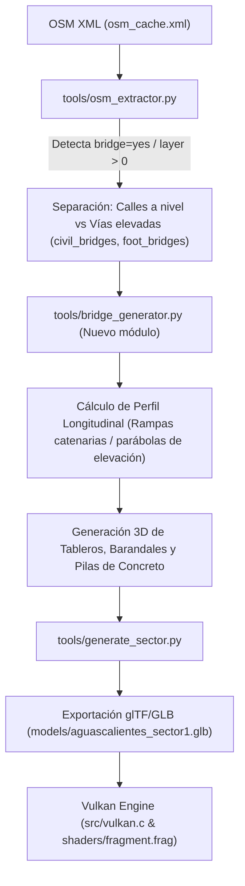

# Plan de Implementación: Puentes Peatonales y Civiles en StreetVulkan 🌉

## 1. Visión General y Contexto
En el dataset actual de OpenStreetMap para Aguascalientes ya disponemos de:
- **10 Puentes Civiles / Viaductos vehiculares** (e.g. *Av. Convención de 1914 Poniente*, *Paseo de la Cruz*, *Calle José F. Elizondo [Viaducto layer 1 y 2]*, *José María Chávez*).
- **5 Puentes Peatonales** (`highway=footway/path` con `bridge=yes` y `layer=1`).

Actualmente, el generador de calles en `tools/generate_sector.py` aplana todas las vías contra el suelo usando `mesh_grid.get_mesh_height(x, z) + 0.12`, lo cual hace que los puentes se proyecten sobre el relieve del terreno en vez de elevarse con columnas estructurales, barandales y gálibo vial libre.

---

## 2. Tipos de Puentes a Modelar

### A. Puentes Civiles / Viaductos Vehiculares (Autopistas, pasos a desnivel elevados)
- **Calzada elevada**: Ancho vehicular (7.5m a 11.0m) a altura sobre el terreno ($H = 5.5\text{m}$ a $8.0\text{m}$ o interpolación de rampa suave si conecta con suelo).
- **Tablero estructural**: Base inferior de concreto pretensado (caja o vigas I).
- **Pilas / Columnas de soporte**: Cilindros o prismas de concreto reforzado cada $20\text{m}$ a $25\text{m}$ que bajan verticalmente desde el tablero hasta el terreno real (`terrain_y`).
- **Muros de contención / Estribos**: Rampa inclinada en los extremos de inicio y fin del puente.
- **Barreras laterales (New Jersey)**: Guarnición/murete de concreto de $0.9\text{m}$ de alto a ambos bordes.

### B. Puentes Peatonales Urbanos
- **Pasarela central**: Ancho de $2.0\text{m}$ a $2.5\text{m}$, gálibo vertical de $5.2\text{m}$ libre sobre avenidas.
- **Estructura metálica / Enrejado**: Barandales laterales tubulares de $1.1\text{m}$ de alto con tubos horizontales o malla.
- **Pilares tubulares de acero**: Columnas esbeltas ($r = 0.25\text{m}$) a los costados de la vía.
- **Escaleras y rampas de acceso peatonal**: Descensos en zigzag o rectos en ambos extremos que bajan a la banqueta.

---

## 3. Arquitectura de Datos y Pipeline Técnico

---

## 4. Fases de Ejecución

### Fase 1: Extracción y Clasificación en `osm_extractor.py`
- Añadir detección de tags:
  - `bridge == 'yes'` o `bridge == 'viaduct'`.
  - `layer > 0`.
  - Diferenciar entre vehicular (`highway in ('primary', 'secondary', 'tertiary', 'trunk')`) y peatonal (`highway in ('footway', 'path', 'pedestrian')`).
- Guardar los nodos y referencias de elevación relativa.

### Fase 2: Módulo Geométrico Procedural `tools/bridge_generator.py`
1. `make_civil_bridge_3d(pts_m, road_w, clearance_h=6.0, mesh_grid=None)`:
   - Genera el tablero vehicular elevado.
   - Coloca pilas de concreto verticales (`make_cylinder` o `make_box`) a intervalos regulares hasta la cota del terreno.
   - Genera barreras tipo New Jersey a ambos costados.
2. `make_pedestrian_bridge_3d(pts_m, width=2.2, clearance_h=5.2, mesh_grid=None)`:
   - Genera pasarela peatonal elevada.
   - Genera barandales tubulares de acero.
   - Genera escaleras con peldaños en los extremos.

### Fase 3: Integración en `generate_sector.py`
- Excluir los segmentos con `bridge=yes` del trazado a ras de suelo para evitar superposición.
- Insertar los puentes generados en `all_vertices` con los `matID` correspondientes (asfalto, concreto, metal).
- Actualizar `models/chunks.json` y `models/aguascalientes_sector1.glb`.

### Fase 4: Renderizado y Shading en Vulkan
- El nuevo shader en espacio de mundo aplicará automáticamente:
  - Textura de asfalto en el tablero vial del puente.
  - Concreto en las pilas y vigas inferiores.
  - Sombreado bajo el puente (Self-shadowing ambiental).
