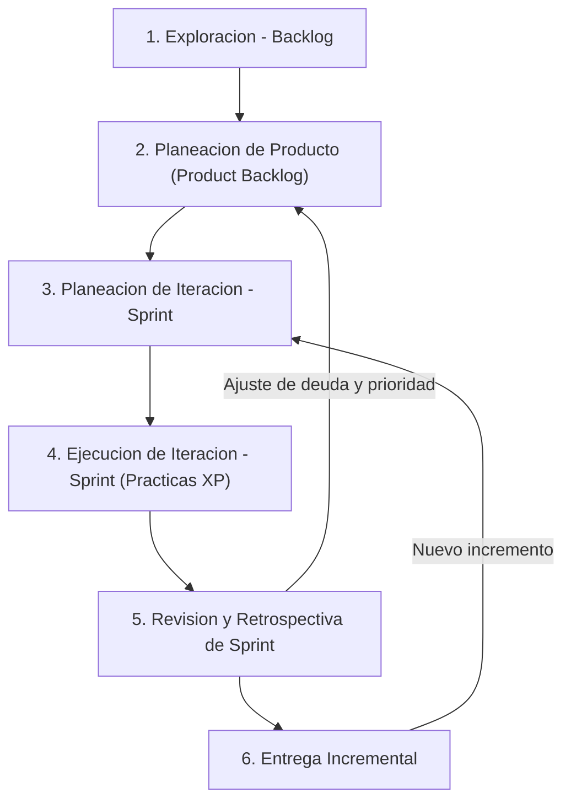

# Proceso Integrado SCRUM-XP Aplicado a StreetVulkan (Parte II — 30%)
## Metodologías de Desarrollo de Sistemas (UAA Clave 24967)

Este documento describe la aplicación del **Proceso Integrado SCRUM-XP** sobre el proyecto **StreetVulkan**, combinando la gestión empírica e iterativa de **Scrum** (roles, artefactos y ceremonias en Sprints) con las prácticas de ingeniería de **Extreme Programming (XP)** (pruebas unitarias automatizadas, sanitizadores ASan/UBSan, refactorización, diseño simple, propiedad colectiva e integración continua).

---

## 1. Modelo del Proceso Integrado SCRUM-XP

De acuerdo con la Unidad Temática IV del programa oficial del curso (Clave `24967`, Dr. Manuel Mora / Dr. Carlos Arévalo), el proceso integrado SCRUM-XP articula seis fases operativas:

| Fase Integrada SCRUM-XP | Objetivo en StreetVulkan | Artefactos Reales Asociados |
| :--- | :--- | :--- |
| **1. Exploración – Backlog** | Identificar necesidades de simulación urbana 3D en Aguascalientes, viabilidad de Vulkan 1.2 + SDL2 y fuentes geoespaciales (OSM, Overture, DENUE, SRTM). | Visión técnica en [README.md](../README.md), prototipos en `tools/` ([geo_dem.py](../tools/geo_dem.py), [generate_sector.py](../tools/generate_sector.py)) |
| **2. Planeación de Producto** | Estructurar y priorizar el **Product Backlog** con Historias de Usuario (`HU-01`..`HU-12`), estimación relativa en *Story Points* y criterios de aceptación. | Product Backlog (Sección 3) y [ROADMAP_FUTURO.md](ROADMAP_FUTURO.md) |
| **3. Planeación de Iteración – Sprint** | Seleccionar el *Sprint Backlog* para Sprints 1–4 según capacidad del equipo y dependencias técnicas (núcleo $\to$ tráfico $\to$ streaming $\to$ calidad Tier S). | Tablas de Sprint Planning (Sección 4) |
| **4. Ejecución de Iteración – Sprint** | Implementar código C/GLSL/Python aplicando prácticas XP (`make test`, `make asan-test`, compilación estricta `-Wall -Wextra`, refactorización). | `src/` ([vulkan.c](../src/vulkan.c)), `include/` ([vulkan_types.h](../include/vulkan_types.h)), [vertex.vert](../shaders/vertex.vert), [test_c_modules.c](../tests/test_c_modules.c) |
| **5. Revisión y Retrospectiva** | Demostrar incrementos ejecutables y auditorías automáticas; identificar deuda técnica abierta (`ped_system` sin render GPU, funciones `CC > 20` para Tier B). | Actas de Revisión y Retrospectiva (Sección 6) |
| **6. Entrega Incremental** | Consolidar binario compilable, activos modulares ($\le 99\text{ MB}$), suite de métricas ISO/IEC SQuaRE y pipeline CI. | [Makefile](../Makefile), [ci.yml](../.github/workflows/ci.yml), `build/quality_scorecard.json` |

---

## 2. Roles SCRUM-XP en StreetVulkan

| Rol | Responsabilidades Principales | Aplicación en StreetVulkan |
| :--- | :--- | :--- |
| **Product Owner (PO)** | Define la visión urbana, prioriza el Product Backlog, valida criterios de aceptación y gestiona el alcance frente a restricciones de hardware ($\le 99\text{ MB}$/sector, $\ge 60\text{ FPS}$). | Priorización de entregas: primero núcleo Vulkan y ciudad de Aguascalientes, luego simulación vehicular/semafórica, escalabilidad en macro-sectores y finalmente calidad/Tier S. |
| **Scrum Master (SM)** | Facilita ceremonias (Sprint Planning, Daily, Review, Retrospective), remueve impedimentos técnicos (cuellos de botella de RAM/VRAM, desfases geodésicos) y vela por el cumplimiento de XP y la Definición de Terminado (DoD). | Supervisión de límites de compilación cero-warnings, prevención de deuda oculta en scorecards y coordinación entre módulos C y pipeline Python. |
| **Equipo de Desarrollo / XP** | Equipo multifuncional auto-organizado encargado de arquitectura, codificación C11/Vulkan/GLSL/Python, pruebas unitarias XP, ASan/UBSan y refactorización bajo propiedad colectiva. | Mantenimiento conjunto de `src/`, `include/`, `shaders/`, `tools/` y `tests/` ([Makefile](../Makefile)). |

---

## 3. Product Backlog (`HU-01`..`HU-12`)

**Definición de Terminado (Definition of Done — DoD):**
1. Compilación limpia con `gcc -Wall -Wextra -O2` y `glslangValidator -V` sin advertencias ni errores.
2. Pruebas unitarias en [test_c_modules.c](../tests/test_c_modules.c) y [test_python_tools.py](../tests/test_python_tools.py) aprobadas (`make test`).
3. Ejecución sin fugas ni errores de memoria bajo AddressSanitizer/UBSan (`make asan-test`).
4. Verificación de calidad ISO/IEC SQuaRE sin fallos bloqueantes (`make metrics`).

| ID | Historia de Usuario (Como / Quiero / Para) | Prioridad | Story Points | Criterios de Aceptación Verificables |
| :--- | :--- | :---: | :---: | :--- |
| **HU-01** | **Como** usuario del simulador, **quiero** navegar libremente en 3D con cámara WASD+ratón sobre Vulkan 1.2 y SDL2, **para** inspeccionar la escena sin bloqueos ni fallos al redimensionar la ventana. | Alta | 8 | Ventana SDL2+Vulkan inicializa `VkInstance`/`VkDevice`; `VK_ERROR_OUT_OF_DATE_KHR` recrea la swapchain sin leaks; cámara responde con `mat4_perspective_vk` y `mat4_lookat` verificados en `test_math_camera()`. |
| **HU-02** | **Como** motor gráfico, **quiero** cargar mallas glTF 2.0/GLB mediante mapeo directo `mmap` Zero-Copy y mallas auxiliares `.obj`, **para** evitar duplicar gigabytes en RAM durante la carga urbana. | Alta | 8 | [vulkan_gltf.c](../src/vulkan_gltf.c) lee `.glb` con `mmap` + `MADV_SEQUENTIAL`; [obj_loader.c](../src/obj_loader.c) carga `models/test.obj` con `36` vértices triangulados y maneja `NULL`/inexistentes sin crash (`test_obj_loader_and_sector_bounds()`). |
| **HU-03** | **Como** ingeniero geoespacial, **quiero** generar proceduralmente sectores urbanos 3D de Aguascalientes desde OSM, Overture, DENUE y DEM satelital, **para** reconstruir vialidades, banquetas, puentes y edificios clasificados. | Alta | 13 | [generate_sector.py](../tools/generate_sector.py), [classify_buildings.py](../tools/classify_buildings.py) y [bridge_generator.py](../tools/bridge_generator.py) producen `classified_buildings.json` (`325,511` reg.) y mallas glTF 2.0 válidas; triangulación verificada en `TestTopographyMath`. |
| **HU-04** | **Como** sistema de simulación física y escena, **quiero** una función topográfica unificada en C y Python sobre la grilla `64x64` con datum `1871.0 m`, ríos y fallas, **para** que vehículos, cámara y props se asienten con $\Delta Y < 0.05\text{ m}$. | Alta | 5 | `terrain_dem_get_elevation()` en [terrain_dem_data.h](../include/terrain_dem_data.h) y `vulkan_get_ground_elevation()` en [vulkan.c](../src/vulkan.c) coinciden con [geo_dem.py](../tools/geo_dem.py) ($\Delta Y < 0.05\text{ m}$ en `test_dem_topography_precision()` y check `Q-FNC-02`); `1871.0` unificado en importadores de foto. |
| **HU-05** | **Como** pipeline de renderizado PBR, **quiero** cargar textura satelital en 4 cuadrantes, atlas 16x16 y mapas de iluminación con fallback seguro, **para** renderizar materiales Cook-Torrance sin corromper memoria ni fallar si faltan PNGs satelitales. | Alta | 8 | [vulkan_texture.c](../src/vulkan_texture.c) valida dimensiones de cuadrantes (`q00..q11`), respeta límites de `samplerAnisotropy` y `BLIT_SRC`/`BLIT_DST`, y genera fallback `4x4` creando `LightingUBO`, `textureSampler` y `descriptorSets`. |
| **HU-06** | **Como** observador de movilidad urbana, **quiero** simular 200 vehículos instanciados circulando por la red vial binaria `RGP1`, **para** visualizar tráfico realista frenando ante intersecciones en rojo con bajo costo de draw calls. | Alta | 13 | [road_graph.c](../src/road_graph.c) carga [road_network.bin](../models/road_network.bin) (`34,658` nodos, `48,640` aristas) con CSR válido; [car_system.c](../src/car_system.c) actualiza `200` coches (`6` tipos) y desacelera/activa `brake=1.0` ante luz roja (`test_car_system_headless()`). |
| **HU-07** | **Como** operador de tráfico y ambiente, **quiero** semáforos deterministas de 6 fases e iluminación dinámica de 64 luces + ciclo solar + linterna, **para** observar transiciones viales y alumbrado nocturno realistas. | Alta | 8 | [traffic_system.c](../src/traffic_system.c) gestiona `552` semáforos y resuelve `intersectionIndex` tras `realloc` (`test_traffic_system_fsm()`, `test_traffic_system_o1_intersection_resolution()`); [lighting_system.h](../include/lighting_system.h) selecciona hasta `64` luces en `LightingUBO`. |
| **HU-08** | **Como** motor de mundo abierto, **quiero** dividir la ciudad en macro-sectores de `1024 m` ($\le 99\text{ MB}$) con streaming asíncrono POSIX y culling de chunks de `128 m`, **para** sostener $\ge 60\text{ FPS}$ sin exceder VRAM. | Alta | 13 | [sector_system.c](../src/sector_system.c) lee `401` sectores de [sectors.json](../models/sectors.json) con hilo trabajador `pthread` y liberación diferida; [frustum_cull.h](../include/frustum_cull.h) descarta AABBs fuera de vista (`test_frustum_culling()`, `test_sector_system_manifest()`). |
| **HU-09** | **Como** gestor de recursos Vulkan, **quiero** subasignar `VkBuffer` y `VkImage` desde pools centrales por tipo de memoria con coalescencia, **para** minimizar llamadas a `vkAllocateMemory` y evitar fugas en streaming. | Media | 8 | [vulkan_memory_pool.c](../src/vulkan_memory_pool.c) separa `vramBufferPool`, `vramImagePool` y `hostVisiblePool`; subasignación alineada, coalescencia y rebobinado pasan `test_vulkan_memory_pool()`. |
| **HU-10** | **Como** evaluador técnico, **quiero** un overlay de telemetría en vivo (FPS, CPU/GPU ms, culling %) y menú de pausa para pruebas horarias/teleporte, **para** auditar el rendimiento en tiempo real sin recompilar. | Media | 5 | [telemetry.h](../include/telemetry.h) evalúa umbrales ISO/IEC 25022 y exporta JSON (`test_recoverability_and_iso25022()`); [debug_overlay.h](../include/debug_overlay.h) y [pause_menu.h](../include/pause_menu.h) operan con `ESC`/`P`. |
| **HU-11** | **Como** responsable de calidad, **quiero** automatizar pruebas C/Python, ASan/UBSan, auditoría de datos y evaluación SQuaRE en Makefile y GitHub Actions, **para** garantizar cero regresiones y reportes honestos. | Alta | 8 | `make quality` y [ci.yml](../.github/workflows/ci.yml) ejecutan compilación, `make test`, `make asan-test` y `tools/metrics/*.py`; `evaluate_iso25040.py` distingue `PASS`, `WARN` y `FAIL` sin maquillar deuda técnica. |
| **HU-12** | **Como** arquitecto de simulación multimodal, **quiero** modelar la cinemática base de peatones sincronizada con semáforos y documentar su hoja de ruta GPU, **para** habilitar futuras entregas de peatones instanciados. | Baja | 5 | [ped_system.c](../src/ped_system.c) pasa `test_ped_system()` (espera en verde vehicular, cruza en rojo); su integración visual en GPU (`models/peds/ped.glb`) queda planificada en [ROADMAP_FUTURO.md](ROADMAP_FUTURO.md). |

**Total del Product Backlog:** `12` Historias de Usuario | `102` Story Points.

---

## 4. Planificación y Ejecución por Sprints (Sprints 1–4)

| Sprint | Enfoque e Historias Comprometidas | Puntos | Entregables Reales en el Repositorio | Estado |
| :---: | :--- | :---: | :--- | :---: |
| **Sprint 1** | **Núcleo Gráfico Vulkan, Carga glTF/OBJ y Pipeline PBR** (`HU-01`, `HU-02`, base `HU-05`) | 24 | [main.c](../src/main.c), [vulkan.c](../src/vulkan.c), [vulkan_device.c](../src/vulkan_device.c), [vulkan_swapchain.c](../src/vulkan_swapchain.c), [vulkan_pipeline.c](../src/vulkan_pipeline.c), [vulkan_gltf.c](../src/vulkan_gltf.c), [obj_loader.c](../src/obj_loader.c), [math_camera.c](../src/math_camera.c), [vertex.vert](../shaders/vertex.vert), [fragment.frag](../shaders/fragment.frag). | Completado |
| **Sprint 2** | **Pipeline Geoespacial Aguascalientes, Red Vial, Vehículos y Semáforos** (`HU-03`, `HU-06`, `HU-07`) | 29 | [geo_dem.py](../tools/geo_dem.py), [classify_buildings.py](../tools/classify_buildings.py), [generate_road_graph.py](../tools/generate_road_graph.py), [generate_sector.py](../tools/generate_sector.py), [sector_terrain.py](../tools/sector_terrain.py), [sector_roads.py](../tools/sector_roads.py), [road_graph.c](../src/road_graph.c), [car_system.c](../src/car_system.c), [traffic_system.c](../src/traffic_system.c), [lighting_system.h](../include/lighting_system.h). | Completado |
| **Sprint 3** | **Macro-Sectores (<99 MB), Memory Pool, Frustum Culling y Telemetría HUD** (`HU-08`, `HU-09`, `HU-10`) | 26 | [split_glb_to_sectors.py](../tools/split_glb_to_sectors.py), [sector_system.c](../src/sector_system.c), [vulkan_memory_pool.c](../src/vulkan_memory_pool.c), [chunk_system.h](../include/chunk_system.h), [frustum_cull.h](../include/frustum_cull.h), [telemetry.h](../include/telemetry.h), [debug_overlay.h](../include/debug_overlay.h), [pause_menu.h](../include/pause_menu.h). | Completado |
| **Sprint 4** | **Calidad SQuaRE, Prácticas XP, Sanitizadores ASan/UBSan y Remediación Tier S** (`HU-04`, cierre `HU-05`, `HU-11`, `HU-12`) | 23 | [test_c_modules.c](../tests/test_c_modules.c), [test_python_tools.py](../tests/test_python_tools.py), [ci.yml](../.github/workflows/ci.yml), `tools/metrics/*.py`, unificación DEM `1871.0 m` ([terrain_dem_data.h](../include/terrain_dem_data.h)), fallback `4x4` en [vulkan_texture.c](../src/vulkan_texture.c), [ped_system.c](../src/ped_system.c) + suite documental `docs/`. | Completado (con deuda Tier B documentada) |

---

## 5. Prácticas de Extreme Programming (XP) Aplicadas

| Práctica XP | Implementación Concreta en StreetVulkan | Evidencia Verificable |
| :--- | :--- | :--- |
| **Pruebas Unitarias Continuas** | Suite C sin dependencia de ventana gráfica (*headless*) cubriendo álgebra de cámara, culling frustum, FSM de semáforos, grafo binario `RGP1`, memory pool, cinemática vehicular, manifiesto de sectores, topografía DEM y peatones; complementada con `unittest` en Python. | [test_c_modules.c](../tests/test_c_modules.c), [test_python_tools.py](../tests/test_python_tools.py), target `make test` |
| **Sanitización de Memoria (ASan/UBSan)** | Compilación instrumentada con `-fsanitize=address,undefined -fno-omit-frame-pointer` para detectar desbordamientos de heap, uso tras liberación (*use-after-free*) y comportamiento indefinido en módulos de simulación y parsing. | Target `asan-test` en [Makefile](../Makefile) |
| **Refactorización Continua** | Descomposición del generador monolítico en [sector_terrain.py](../tools/sector_terrain.py) y [sector_roads.py](../tools/sector_roads.py); delegación de `vulkan_get_ground_elevation()` hacia helpers limpios en [terrain_dem_data.h](../include/terrain_dem_data.h); extracción de subfunciones en [vulkan_texture.c](../src/vulkan_texture.c) (`CC <= 13`). **Deuda abierta:** `16` funciones con `CC > 20` (`max=70`) y `4.8%` de comentarios programadas para **Tier B**. | Reporte automático de [measure_maintainability.py](../tools/metrics/measure_maintainability.py) (`WARN`) |
| **Integración Local y CI** | Compuerta automática local (`make quality`: `clean all test asan-test metrics`) y flujo de integración continua en GitHub Actions ante cada `push` o `pull_request` a `main`. | [Makefile](../Makefile) y [ci.yml](../.github/workflows/ci.yml) |
| **Propiedad Colectiva del Código** | Separación modular `.h` / `.c` por dominio con reglas estrictas de compilación (`-Wall -Wextra -O2`) que permiten a cualquier integrante corregir o extender módulos sin silos de conocimiento. | Cabeceras documentadas en `include/` (ej. [vulkan_types.h](../include/vulkan_types.h), [sector_system.h](../include/sector_system.h)) |
| **Diseño Simple (KISS / YAGNI)** | Uso de parsers JSON ligeros en C sin librerías externas pesadas (`chunk_system.h`, `sector_system.c`, `traffic_system.c`), formato binario `RGP1` empaquetado directamente en structs y carga `mmap` Zero-Copy en lugar de capas ORM complejas. | [road_graph.h](../include/road_graph.h), [vulkan_gltf.c](../src/vulkan_gltf.c) |

---

## 6. Actas de Revisión y Retrospectiva por Sprint

### Sprint 1 — Revisión y Retrospectiva (Núcleo Vulkan y glTF)
- **Incremento Demostrado:** Inicialización de Vulkan 1.2 sobre SDL2, render pass con buffer de profundidad, shader PBR Cook-Torrance GGX/Schlick ([fragment.frag](../shaders/fragment.frag)) y carga `mmap` Zero-Copy de `.glb`.
- **Retrospectiva (Qué funcionó / Qué mejorar):**
  - *Positivo:* `mmap` redujo drásticamente el consumo de RAM respecto a lecturas estándar con duplicación de buffers.
  - *Problema detectado:* Un archivo único `aguascalientes_sector1.glb` superaba `2.5 GB`, volviendo inviable la carga en GPUs integradas y la portabilidad en repositorio.
  - *Acción tomada:* Planificar partición espacial en chunks de `128 m` y macro-sectores $\le 99\text{ MB}$ para el Sprint 3.

### Sprint 2 — Revisión y Retrospectiva (Red Vial, Tráfico y Generación Urbana)
- **Incremento Demostrado:** Pipeline Python de Aguascalientes (`325,511` edificios clasificados, `552` semáforos, `road_network.bin` con `34,658` nodos y `48,640` aristas), simulación de `200` vehículos en 6 draw calls instanciados y `64` luces dinámicas en GPU.
- **Retrospectiva:**
  - *Positivo:* El instancing por `CarInstanceData` (96 bytes por instancia) mantuvo bajo el conteo de draw calls.
  - *Problema detectado:* Error de cota DEM en la generación inicial del grafo vial (corregido en commit `5cf90d6`) y vulnerabilidad de puntero colgante al hacer `realloc` de intersecciones en `traffic_system.c` (corregida usando `intersectionIndex` entero).

### Sprint 3 — Revisión y Retrospectiva (Escalabilidad y Telemetría)
- **Incremento Demostrado:** `401` macro-sectores GLB ($\le 76.94\text{ MB}$ cada uno), hilo trabajador `pthread` en [sector_system.c](../src/sector_system.c), liberación diferida segura por *frames in flight*, subasignadores separados (`vramBufferPool`, `vramImagePool`, `hostVisiblePool`) y menú de pausa/telemetría.
- **Retrospectiva:**
  - *Positivo:* Separar el pool de imágenes y buffers resolvió conflictos de `bufferImageGranularity` en Vulkan.
  - *Deuda observada:* La complejidad ciclomática de funciones largas en `vulkan.c`, `car_system.c` y `sector_system.c` creció por encima de `CC = 20`, afectando la analizabilidad.

### Sprint 4 — Revisión y Retrospectiva (Calidad ISO SQuaRE, Prácticas XP y Correcciones Tier S)
- **Incremento Demostrado:**
  - Suite de pruebas C (`test_c_modules.c`: actualmente `15` funciones de prueba) + ASan/UBSan (`make asan-test`) + pruebas Python (`test_python_tools.py`: actualmente `18` métodos `unittest`). `make test` descubre también las pruebas adicionales disponibles bajo `tests/`; el conteo puede cambiar cuando se agreguen casos.
  - **Corrección Tier S #1 (Topografía DEM):** Unificación del datum `1865.0 m` $\to$ `1871.0 m` y reemplazo de la grilla `40x40` por `64x64` (`dem_terrarium_21.800_21.950_-102.370_-102.245_64x64.json`) con 4 ríos y 2 fallas geológicas en [terrain_dem_data.h](../include/terrain_dem_data.h) e importadores de fotografía (`max_diff = 0.000018 m` en `Q-FNC-02`, `3.03e-05 m` en grilla 50×50).
  - **Corrección Tier S #2 (Textura Satelital y UBO):** Eliminación de retorno prematuro sin descriptores cuando faltan PNGs satelitales mediante textura fallback `4x4`, validación de dimensiones en `load_quadrant_satellite()`, chequeo de soporte físico de `samplerAnisotropy` y capacidades de blit en [vulkan_texture.c](../src/vulkan_texture.c).
  - **Corrección Tier S #3 (Transparencia de Métricas):** Eliminación de scorecards inflados al 100% artificial; implementación de estado `WARN` honesto en [evaluate_iso25040.py](../tools/metrics/evaluate_iso25040.py) (`4 PASS, 1 WARN, 0 FAIL`) y [measure_maintainability.py](../tools/metrics/measure_maintainability.py).
- **Retrospectiva y Deuda Técnica Abierta (Compromiso Post-Sprint 4):**
  1. **Integración visual de peatones (`ped_system`):** [ped_system.c](../src/ped_system.c) y [ped_system.h](../include/ped_system.h) cuentan con lógica cinemática/semafórica probada en CPU (`test_ped_system()`), pero **aún no están conectados al bucle de renderizado instanciado en GPU** en [vulkan.c](../src/vulkan.c) (mantenido explícitamente en [ROADMAP_FUTURO.md](ROADMAP_FUTURO.md)).
  2. **Refactorización de Complejidad Ciclomática (Tier B):** Las `16` funciones reportadas con `CC > 20` (encabezadas por `gltf_load_direct_vulkan` `CC=70`, `obj_load` `CC=62`, `car_system_update` `CC=58`, `main` `CC=51`) y la densidad de comentarios (`4.8% < 5.0%`) quedan formalmente programadas para descomposición modular en **Tier B**.
  3. **Validación Vulkan con Capas Khronos en Display:** La ejecución automatizada en CI corre pruebas headless; la inspección prolongada ($\ge 5\text{ min}$) con `VK_LAYER_KHRONOS_validation` requiere sesión gráfica activa con driver Vulkan.
